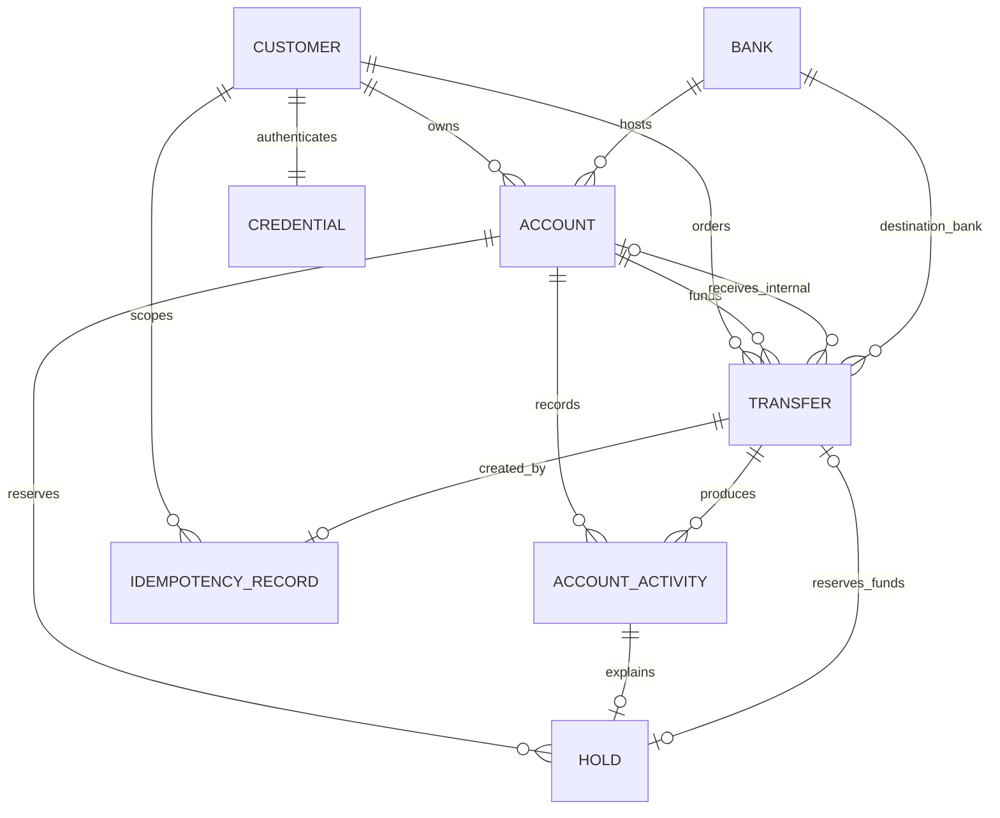
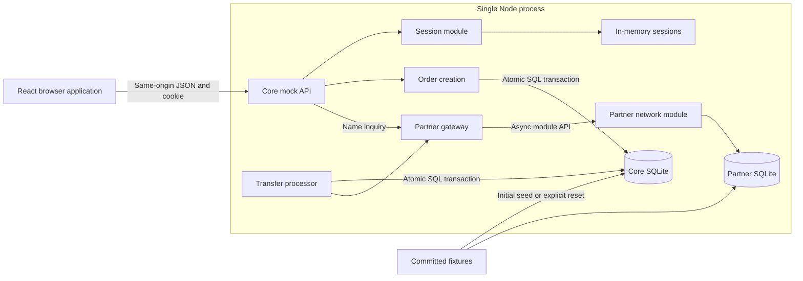

# Demo Banking Worksample

Status: approved; describes the implemented application (2026-11-01). How it is built is described in the [technical design](technical-design/README.md).

The source brief is reproduced in [Appendix B](#appendix-b-source-brief). Canonical terms are defined in [Appendix A](#appendix-a-glossary).

The key words **MUST**, **MUST NOT**, **SHOULD**, **SHOULD NOT**, and **MAY** in this document are to be interpreted as described in BCP 14 ([RFC 2119](https://www.rfc-editor.org/rfc/rfc2119), [RFC 8174](https://www.rfc-editor.org/rfc/rfc8174)) when, and only when, they appear in all capitals. Statements without these keywords are descriptive.

## 1. Outcome and scope

The implementation MUST be a runnable personal banking web application that demonstrates reliable money movement, a deliberate domain model, realistic mock data, and clear frontend architecture. Its layout and interaction patterns SHOULD support the personal banking workflows and visual design described below.

The implementation covers the core requirements plus transaction detail, insights, authentication, architecture diagrams and automated tests. The exclusions below define its limits.

| Brief requirement | Required result                                                                                                                                                                                                     |
| ----------------- | ------------------------------------------------------------------------------------------------------------------------------------------------------------------------------------------------------------------- |
| Accounts          | Identify each account, its value, and usability at a glance.                                                                                                                                                        |
| Transactions      | Browse account activity, locate a particular entry with search/filters, and open its details.                                                                                                                       |
| Transfers         | Create transfer orders to own accounts, another customer of the demo bank, or an account at another bank. Validate the order, process it, update all locally modeled balances consistently, and report its outcome. |
| Data              | A server-owned banking model, realistic committed fixtures, SQLite persistence, atomic order creation and execution, and a separately stored mock partner-bank network.                                             |
| Deliverables      | Working application, local instructions, mock data, README, and three ADRs.                                                                                                                                         |
| Optional depth    | Transaction detail, spending insights, login/protected routes/session handling, system/schema diagrams, and meaningful automated tests.                                                                             |

### Included

- One signed-in demo customer; additional customer fixtures provide same-bank recipients.
- English UI; a single currency, JPY. All accounts, amounts, and totals are JPY.
- Asynchronous transfer processing: an order is created synchronously, then executed by a server-side processor. Internal transfers execute locally; external transfers go through a mock partner-bank network module.
- Available/current balances, seeded merchant holds, and transfer holds that reserve funds while an order is processing.
- Recipient lookup that fills in the registered account holder name, with manual name entry when the name cannot be displayed and name verification at execution.
- Transfer tracking through Account activity and Activity Details, including processing and failed transfers; no separate transfer history or transfer detail page.
- Hide/show monetary amounts as a shoulder-surfing privacy control.
- Responsive desktop/mobile layouts and keyboard-accessible interactions.
- Deterministic demo controls that create order rejections, execution failures, transport failures, and account status changes during processing, plus session expiry and reset.

### Deliberately excluded

- Multiple currencies, FX, fees, overdrafts, credit, interest accrual, and daily/monthly cumulative transfer limits.
- Refunds and purchase reversals.
- Real bank connectivity, real account-name verification, clearing, returns, reversals of completed transfers, scheduled transfers, and settlement cut-off times.
- Next-business-day handling of manually named transfers; they are processed like any other order.
- Idle (inactivity) session timeout, expiry warnings, and keep-alive. The brief asks for login, protected routes, and token handling; sessions use an absolute expiry only.
- Saved recipients and recipient management.
- Recovery of an unconfirmed submission across page refresh, navigation, or login. Within one open review page the client retries safely; otherwise the customer checks Account activity.
- Activity CSV export.
- Registration, recovery, MFA/OTP, approvals, employee roles, batch payments, attachments, and server-side draft management.
- Account opening/closure actions for customers, dormant-account policies, card management, ATM operations, points, campaigns, and commerce payments.
- Capture/release/expiry of seeded merchant holds. They are fixed seed scenarios until reset. Transfer holds are captured or released by transfer processing.
- Automated concurrency tests at the service level. Concurrent orders are serialized by the order-creation transaction (section 7) and verified manually with multiple browser tabs.
- Production deployment as an interview deliverable. Production security assumptions remain documented.

### Branding

The product name is **Demo Banking** with an original logo: a simple monochrome wordmark consistent with the charcoal-and-white visual hierarchy. The UI and logo MUST use original branding. The README and the login page footer MUST state that the project is an independent personal banking worksample.

## 2. Research references

The following references inform recipient lookup, input constraints, and payment reliability. The worksample policies are defined in this specification.

| Evidence                                                                                                                                                                                                                                                                                                                                                                                                                                                                                                | Observed behavior                                                                                                                                                                                                  | Worksample treatment                                                                                                                                   |
| ------------------------------------------------------------------------------------------------------------------------------------------------------------------------------------------------------------------------------------------------------------------------------------------------------------------------------------------------------------------------------------------------------------------------------------------------------------------------------------------------------- | ------------------------------------------------------------------------------------------------------------------------------------------------------------------------------------------------------------------ | ------------------------------------------------------------------------------------------------------------------------------------------------------ |
| Recipient-name display: [SMBC](https://www.smbc.co.jp/direct/help_furikomi/12.html), [SMBC limits](https://www.smbc.co.jp/direct/help_furikomi/7.html), [Sumishin SBI](https://www.netbk.co.jp/contents/company/press/2017/corp_news_20171113.html), [PayPay Bank](https://www.paypay-bank.co.jp/payment/bal_remittance/receiver.html), [SMTB](https://www.smtb.jp/personal/direct/internet/help/help_hurikomi), [AEON Bank](https://www.aeonbank.co.jp/guide/taiken/04_bank_transfer/KBE11BN001B.html) | Holder name displayed after bank/account entry. Repeated lookups without a transfer disable the function; the customer may then type the name, possibly with next-business-day processing and failure on mismatch. | Name auto-filled on account-number blur, a lookup-without-transfer limit, and manual name entry verified at execution (section 4, _Recipient lookup_). |
| [UK Confirmation of Payee](https://docs.griffin.com/docs/guides/confirmation-of-payee), [EU Verification of Payee](https://docs.weavr.io/transactions/vop/overview)                                                                                                                                                                                                                                                                                                                                     | Payer supplies a name; payee bank answers match/close match/no match/unavailable.                                                                                                                                  | Not adopted; minimal-disclosure and clear-outcome principles are adopted.                                                                              |
| Zengin character conventions: [Yayoi](https://www.yayoi-kk.co.jp/content/dam/yayoi-corp/yss/furikomi/download/pdf/setumei.pdf), [SMBC](https://www.smbc.co.jp/direct/help_furikomi/40.html), [Rakuten Bank](https://www.rakuten-bank.co.jp/login/transfer-name.html)                                                                                                                                                                                                                                    | Interbank text fields accept a restricted set: digits, Latin letters, kana, space, and a few symbols `( ) . - /`; banks vary.                                                                                      | Reference uses a Latin subset of this set (section 4).                                                                                                 |
| Payment timeouts: [Stripe](https://docs.stripe.com/error-low-level), [Gr4vy](https://docs.gr4vy.com/guides/timeouts), [Flutterwave](https://developer.flutterwave.com/docs/handling-error-timeouts), [Mastercard Send](https://developer.mastercard.com/mastercard-send-funding/documentation/tutorials-and-guides/exception-management/)                                                                                                                                                               | A timeout is an unknown outcome, never a failure; retry with the same idempotency key; exponential backoff with jitter; status polling with bounded frequency.                                                     | Client submission and polling policy (section 7).                                                                                                      |

Balance terminology is informed by [TD's posted/available explanation](https://www.td.com/us/en/personal-banking/learning/money-management/available-balance-vs-posted-balance) and [U.S. Bank's balance breakdown](https://www.usbank.com/customer-service/knowledge-base/KB0180641.html). The formula in this specification is a deliberately limited demo policy, not a universal bank formula.

## 3. Navigation and routes

Desktop: charcoal topbar and grouped sidebar. Mobile: compact topbar, fixed Home / Activity / Transfer / Menu navigation; Menu exposes account information, account activity, insights, demo controls, and logout. Approval-related destinations MUST NOT appear.

| Navigation                     | Route                    | Purpose                                                                                                                                               |
| ------------------------------ | ------------------------ | ----------------------------------------------------------------------------------------------------------------------------------------------------- |
| Home                           | `/`                      | Balances and account usability at a glance.                                                                                                           |
| Transfers / New transfer       | `/transfers/new`         | Own-account or recipient transfer wizard.                                                                                                             |
| Legacy transfer link           | `/transfers/:transferId` | Redirect to the source Activity Details; no separate detail screen. If the source activity is inaccessible, return to Activity filtered to transfers. |
| Accounts / Account activity    | `/activity`              | Searchable/filterable monthly activity and transfer tracking.                                                                                         |
| Activity detail                | `/activity/:activityId`  | Activity Summary followed by type-specific sections; Transfer Details includes execution status, full transfer data and recovery actions.             |
| Accounts / Account information | `/accounts`              | All accessible accounts and their identifying/balance/status fields.                                                                                  |
| Account detail                 | `/accounts/:accountId`   | Identity, restrictions, balance breakdown, activity link, transfer entry point.                                                                       |
| Accounts / Insights            | `/insights`              | Monthly income/spending and trends.                                                                                                                   |
| Menu (mobile)                  | `/menu`                  | Account information, account activity, insights, demo controls and logout, opened from the bottom navigation.                                         |
| Legacy transfer list           | `/transfers`             | Redirect to `/activity?cat=transfer`.                                                                                                                 |
| Login                          | `/login`                 | Demo credentials, validation, and sign-in feedback.                                                                                                   |

All routes except login MUST require a server-authenticated session. Direct links and refresh MUST work. Unknown or inaccessible resource IDs MUST show a safe not-found view without exposing another customer's data.

## 4. Screen behavior

### Home and accounts

- Home MUST show all six open owned accounts in compact cards/rows with account name/type, masked number, available balance, status, and restriction explanation when relevant.
- The summary MUST show total current and total available across open accounts, labeled accordingly. Restricted money MUST NOT be described as transferable.
- Home MUST provide an explicit refresh of balances and recent activity, with the accounts' last-successful-refresh timestamp. A session-owned transfer monitor refreshes balances and recent activity on order creation and terminal outcomes, independently of which route is mounted. Home does not own transfer polling.
- Home MUST show the five most recent activity entries of the current JST month, each linking to its detail, with a link to Account activity.
- Account information MUST list all accessible accounts and link to detail. Detail MUST show the full account number with a copy action and confirmation.
- Detail MUST prominently show Available, with Current and On hold breakdown. On hold MUST distinguish merchant authorizations from processing transfers and link to each. A restricted account retains its real balance and activity; transfer controls MUST explain why they are unavailable.
- Closed accounts MUST be excluded from lists, summaries, filters, and recipient eligibility, and their details/activity MUST NOT be viewable through the application or API. No archive UI is included.
- A transfer or activity entry that references a closed account or another customer's account MUST show only its stored snapshot (name, bank, masked number) and MUST NOT link to it.

| Display status | Model                                   | Send | Receive | View |
| -------------- | --------------------------------------- | ---- | ------- | ---- |
| Active         | `lifecycle=open`, `restriction=none`    | Yes  | Yes     | Yes  |
| Restricted     | `lifecycle=open`, `restriction=blocked` | No   | No      | Yes  |
| Closed         | `lifecycle=closed`                      | No   | No      | No   |

This permission matrix is the agreed conservative demo policy. Restriction reasons are plain-language fixture values. Restricted account balances are not set to zero.

### Hide/show amounts

Hiding amounts protects against shoulder surfing on shared screens. It is a display privacy control, not an access-control boundary: the API still returns amounts to the authenticated customer.

- A toggle MUST appear in the Home balance panel (desktop and mobile), with an accessible name stating the action ("Hide amounts" / "Show amounts") and exposed pressed state.
- Default is shown. The preference is a non-sensitive boolean stored in localStorage per device; reads and writes MUST be wrapped in try/catch and fall back to shown. It survives logout as a device preference.
- When hidden, every monetary value on Home MUST render as a fixed-width placeholder (`¥ ••••••`) so length does not reveal magnitude: totals, account balances, on-hold amounts and recent activity amounts.
- Every other page, including the transfer wizard (source available balance, amount, resulting balance), is reached by deliberate navigation and always shows amounts regardless of the preference.
- While hidden, the real value MUST NOT be present in the DOM, accessible name, `title`, or copy buffer; screen readers announce "Amount hidden". CSS blur alone is not acceptable.

### Account activity

- Default: all open accounts, current JST calendar month, **newest first** by effective date, 20 entries per page. Ordering MUST be stable, using the activity sequence to break timestamp ties. The customer MAY switch to oldest first.
- Rows display date/time, description/counterparty, account when viewing all accounts, debit/credit amount, category, and Posted/Pending/Cancelled status.
- Running current balance MUST be shown only when a single account is selected, and MUST be computed by the server from the complete posted ledger, not the current filtered page. Pending and Cancelled entries show no running balance.
- Search MUST match case-insensitive substrings over description, counterparty, transfer reference, and transfer ID; input is trimmed and debounced by 300 ms.
- Filters are single-select: account, month or custom inclusive date range, direction, entry status (Posted/Pending/Cancelled), transfer status (Processing/Completed/Failed), and category. Search and filters combine with AND.
- Filters, sort, and pagination MUST be URL parameters; changing filters returns to page 1; refresh/back/forward restore them, including applied custom-date inputs and panel visibility. A page beyond the result count MUST be replaced in the URL with the last valid page (page 1 for no results), preserving other filters. Every active filter, including one applied by insights drill-down, MUST be visible and removable, and Clear filters MUST clear all of them.
- A custom range replaces month selection. Both modes use JST boundaries translated to UTC by the server. Effective date means `postedAt` for posted entries and `occurredAt` for pending/cancelled entries; insights use `postedAt`. Invalid ranges MUST show field-level feedback and MUST NOT issue a query.
- The UI MUST distinguish loading, retrieval error with retry, no activity, and no matching results with Clear filters, and MUST NOT erase previously fetched results during background refresh.
- Row click or its explicit accessible link opens activity detail: ID, amount, direction, state, dates, account, description, category, counterparty, and related transfer or hold information. For an incoming transfer from another customer, detail MUST show only the sender's name snapshot and the reference, without a link to the sender's transfer.

### Categories

Every activity entry MUST have exactly one category, assigned by the bank when the entry is recorded (seed data for this demo). `other` is the fallback when no category matches.

| Kind                           | Allowed categories                                                                                                                                 |
| ------------------------------ | -------------------------------------------------------------------------------------------------------------------------------------------------- |
| `purchase`                     | `groceries`, `dining`, `transport`, `housing`, `utilities`, `shopping`, `health`, `entertainment`, `subscriptions`, `education`, `travel`, `other` |
| `income`                       | `salary`, `other_income`                                                                                                                           |
| `transfer_in` / `transfer_out` | `transfer`                                                                                                                                         |

Display labels: Groceries, Dining, Transport, Housing, Utilities, Shopping, Health, Entertainment, Subscriptions, Education, Travel, Other, Salary, Other income, Transfer.

### New transfer

1. Choose a source account. Account-detail entry (`?from=<accountId>`) preselects the source and opens the wizard at step 2 with a summary and a Change link.
2. Own: choose a different owned Active account. Someone else: select a bank, enter the seven-digit account number, and obtain the recipient name by lookup or, where lookup cannot display it, by manual entry (section 4, _Recipient lookup_).
3. Enter amount and optional reference. Show source available balance, the per-transfer limit, zero fee, and destination bank/name/account suffix. No date scheduling.
4. Review labeled source, destination, bank, recipient name, amount, zero fee, reference, and resulting source available balance. Change links MUST return to the relevant step without discarding other valid fields. Editing MUST invalidate the previous review and its idempotency key.
5. **Confirm transfer** creates the transfer order. Duplicate submission MUST be disabled while submitting and progress announced. Submission follows section 7, _Client submission and status tracking_.
6. Order created: navigate with `replace` to `/activity/:sourceActivityId`, whose Transfer Details section shows live status (Processing → Completed or Failed). Completed shows reference, timestamp, amount, source/destination, and Make another transfer. Failed shows the actionable reason and allows a corrected new transfer. Order rejected: return to the relevant step with the reason; nothing was recorded.

The recipient bank determines internal/external classification automatically; there are no separate same-bank/other-bank entry flows. Unavailable destinations MAY remain visible with an explanation but MUST NOT be selectable.

Leaving a wizard with unsent changes MUST prompt before discarding. Logout remains available and discards the unsent draft. No transfer MUST ever be submitted automatically after login, a page reload, or route restoration.

### Input rules

- **Amount**: digits only, an integer number of yen. The field MUST use `inputmode="numeric"` and `pattern="[0-9]*"` so mobile devices show a numeric keypad. Commas, periods, spaces, signs, full-width digits, and any other characters MUST be rejected with an inline error rather than stripped or converted. Leading zeros are normalized (`007` → `7`). The formatted value (`¥1,000`) MAY be shown beside the field as a read-only confirmation.
- **Account number**: exactly seven ASCII digits, `inputmode="numeric"`, `maxlength="7"`, same rejection rules.
- **Reference**: optional, 1–140 characters after trimming. Allowed characters are `A–Z`, `a–z`, `0–9`, space, and `( ) . - /`, a Latin subset of the Zengin interbank character set. Any other character MUST be rejected with an inline error naming the allowed set; input MUST NOT be silently altered. Consecutive spaces are collapsed to one before validation and storage. Because all allowed characters are single ASCII code points, length is the count of allowed characters.
- **Recipient name** (manual entry only): 1–30 characters after trimming, same allowed character set and rejection behavior as the reference. For comparison and storage the name is normalized to uppercase with consecutive spaces collapsed, matching how holder names are registered.

### Recipient lookup

The recipient step follows the Japanese bank pattern: choose the bank, enter the account number, and the bank fills in the registered holder name so the customer can confirm the intended recipient before money moves.

**Form**: Bank → Account number → Recipient name.

- Lookup MUST run when the account-number field loses focus with a bank selected and exactly seven digits entered. It MUST also run when the bank changes while a valid account number is present. Lookup MUST NOT run on every keystroke.
- While lookup runs, the step MUST show a loading indicator next to the name field, mark the form `aria-busy="true"`, and disable bank, account number, recipient name, and Next. Lookup has a 5 s timeout, after which the outcome is `unavailable`.
- When lookup returns a name, it MUST fill the recipient name field, **replacing any value already there**, and the field becomes read-only with the note "Name registered at the bank". Editing bank or account number clears the name and its source.
- When lookup cannot display a name (`unavailable` or `rate_limited`), the name field becomes editable and the customer MAY type the name exactly as registered. The UI MUST warn that a name that does not match the registered name will cause the transfer to fail.

| Outcome          | Display                                                                                                                                           | Name field        | Can continue            |
| ---------------- | ------------------------------------------------------------------------------------------------------------------------------------------------- | ----------------- | ----------------------- |
| `found`          | Bank, masked account number (`•••1234`)                                                                                                           | Filled, read-only | Yes                     |
| _(own account)_  | Same as `found`: the registered name is filled and the flow continues unchanged; order creation classifies the destination as `own` (section 10). | Filled, read-only | Yes                     |
| `not_found`      | **Recipient not found** — check bank and account number                                                                                           | Cleared, disabled | No                      |
| `cannot_receive` | "This account can't receive transfers" (no reason disclosed)                                                                                      | Cleared, disabled | No                      |
| `unavailable`    | "The recipient's bank can't display the name right now. Enter the name exactly as registered, or try again." with Retry                           | Editable          | Yes, with a manual name |
| `rate_limited`   | "The name can't be displayed because you've looked up many accounts without making a transfer. Enter the name exactly as registered."             | Editable          | Yes, with a manual name |

- Lookup MUST return only holder name, bank, and outcome. It MUST NOT return balances, account type, restriction reason, or customer ID. `cannot_receive` covers closed, frozen, and restricted accounts without distinguishing them.
- Holder names are shown as registered: uppercase romanized. Internal accounts carry a registered `holderName` in the same form.
- Review MUST show the recipient name and whether it was **Registered at the bank** or **Entered by you**.
- Lookup results use a session-memory query cache with a 5-minute inactive garbage-collection period; they MUST NOT be persisted and are never authoritative. Logout/reset clears the cache. Order creation MUST re-resolve the destination on the server where possible; execution MUST verify the name (section 7).
- Lookup is authenticated, CSRF-protected, and logged with redacted account numbers. It confirms account existence by design; the protections are authentication, the lookup limit, and minimal disclosure.

**Lookup limit.** Following Japanese bank practice, the limit targets lookups that do not lead to a transfer:

- The server MUST count lookups per customer (not per session, so re-login does not reset it). The count MUST reset when the customer creates a transfer order.
- After 10 lookups without an order within a rolling 60 minutes, lookup MUST return `429 LOOKUP_RATE_LIMITED` with `Retry-After` until the oldest counted lookup leaves the window.
- Each valid lookup attempt reserves quota in the same transaction as its limit check, before any partner call. In-flight attempts and all outcomes (`found`, `not_found`, `cannot_receive`, or `unavailable`) count; a lookup rejected with `429` or a validation error does not count.
- While limited, the customer can still transfer to a new recipient by entering the name manually; the name is verified at execution. Own-account transfers are unaffected. Server-side resolution during order creation and execution does not count toward the limit.

### Transfer tracking in Account activity

- Account activity is the single browsing destination for transactions and transfers; there is no separate Transfer history page. Legacy `/transfers` links MUST redirect to `/activity?cat=transfer`.
- Owned transfer entries MUST show Processing, Completed, or Failed alongside their Pending, Posted, or Cancelled ledger state. Processing entries with `delayedSince` set MUST show **Delayed**, still Processing; the Transfer Details section explains the delay.
- The optional `transferStatus` filter MUST select only orders owned by the signed-in customer, combine with other activity filters, use URL state, and appear as a removable chip. Default scope remains the current JST month; earlier transfers use month tabs or a custom range.
- An own-account transfer has one entry per affected account after completion; it remains one transfer order. Failed orders retain their cancelled source entry. Rejected requests have no activity entry.
- A session-owned monitor MUST track pending outgoing transfers independently of route lifetimes, including on balance-only pages. It MUST discover pending orders on authenticated startup/reload and resume on focus/reconnect. Activity lists/details consume shared cache updates; activity detail reads still fetch the entry and its embedded transfer together.
- Activity Details MUST show **Activity Summary** (description, signed amount, account, type/direction, category, counterparty, activity status, timestamps and Activity ID), followed by type-specific sections. Transfer activities MUST show **Transfer Details**, including execution status, delay/failure explanations, full permitted transfer information, Check again, and corrected/new transfer actions. Purchase/income activities currently need only Activity Summary. Activity status and Transfer status MUST be labeled distinctly.
- For owned orders, Activity Details MUST embed the full transfer in `transfer.details`. Incoming transfers owned by another customer MUST set `transfer.details` to null and expose only sender snapshot and reference, never order ID, status, delay metadata or recovery actions. Both entries of an own-account transfer show the same order, with activity-specific signed amounts.
- Activity list links MUST preserve filters and pagination in the detail Back destination. After Confirm, focus the Transfer status heading so the result is immediately visible, including on mobile. Back returns to `/activity?cat=transfer`. Processing-hold links MUST open their activity directly. Legacy transfer-detail URLs MUST redirect to the source activity or the filtered list when the source is inaccessible.
- After Confirm, Back and Account activity actions MUST lead to `/activity?cat=transfer`; when opened from a filtered Activity list, both MUST restore that list URL instead. The unconfirmed-submission recovery link MUST lead to `/activity?cat=transfer`.

### Insights

- The customer selects a calendar month (one of the last 12) and optionally an open owned account.
- Insights MUST show monthly income, monthly spending, spending by category, and a six-month income/spending trend ending in the selected month. While a new uncached month/account selection loads, a skeleton replaces previous amounts and drill-downs; old amounts MUST NOT be relabeled with the new filters.
- Calculations MUST use posted activity only. Income is the sum of `income` entries; spending is the sum of `purchase` entries. Transfers, including transfers to other people, and pending/cancelled entries MUST be excluded.
- Clicking a category or month MAY open activity with corresponding filters, including `status=posted`, the category or month, and the selected account. An empty dataset MUST be announced, and charts MUST have an accessible table equivalent.

## 5. Visual and interaction specification

The visual design uses charcoal navigation, a light-gray canvas, and white content blocks. The boards are in [ui-design/canvas](ui-design/canvas/) (self-contained HTML mockups plus `canvas.json`); [ui-design/screenshots](ui-design/screenshots/) are historical captures of earlier builds. The tokens below are the implemented design-system values (`src/styles/tokens.css`); they define the Demo Banking visual system.

| Semantic token                    | Value / use                                                                                                                                                                       |
| --------------------------------- | --------------------------------------------------------------------------------------------------------------------------------------------------------------------------------- |
| `canvas` / `surface`              | `#F4F5F7` page background / `#FFFFFF` blocks                                                                                                                                      |
| `chrome` / `on-chrome`            | `#2B2F33` topbar and sidebar / `#FFFFFF`; `chrome-hover` `#383D42`, `on-chrome-muted` `#C9CED3`                                                                                   |
| `ink` / `muted`                   | `#2B2F33` text / `#5F6770` secondary text                                                                                                                                         |
| `divider` / `row-divider`         | `#DADDE1` / `#E6E8EB`; `input-border` `#8C949C`                                                                                                                                   |
| `action` / `action-hover`         | `#0066C0` / `#0052A3`: progression, links, focus outline (2 px, 2 px offset); `action-tint` `#F0F6FD` selected option                                                             |
| `confirm` / `confirm-hover`       | `#C2410C` / `#9A3412`: only **Confirm transfer**                                                                                                                                  |
| `ok` / `warn` / `bad`             | `#1E7B34` / `#8A5A00` / `#C0362C`: status text and icons                                                                                                                          |
| `tab` / `tab-hover`               | `#4F555B` / `#5C636A`: month tabs                                                                                                                                                 |
| `chart-income` / `chart-spending` | `#2F7BD0` / `#D97A2B` on `chart-track` `#F1F2F4`; a blue/orange pair distinguishable with color-vision deficiencies                                                               |
| Type                              | Noto Sans 300–600 with a system fallback; 15 px body, 14 px tables/labels, 18 px page headings; large amounts in weight 300; 600 only for button labels; tabular monetary figures |
| Spacing and shape                 | 4 px grid; 4 px block and control radius; flat blocks without borders; one dialog shadow                                                                                          |
| Desktop shell                     | 240 px grouped sidebar, 56 px topbar, 64 px page bar; selected sidebar item white with charcoal text                                                                              |
| Responsive                        | < 810 px mobile shell with bottom navigation (Home · Activity · Transfer · Menu); multi-column layouts collapse below 1101 px and 1200 px; usable at 320 px                       |

Layout rules:

- Each page opens with a white page bar. List pages show the title on the left; drill-down and flow pages show "‹ Back" and a centered title; transfer-flow pages add a 3 px blue underline.
- Content sits in flat white blocks on the gray canvas, with section titles above the block, not inside it.
- Status is icon plus colored text. There are no alert boxes and no red, yellow or green background fills; the only tinted fill is a selected option. Explanations are plain text, with one neutral gray note style.
- Buttons sit in one action bar at the end of the page: flows put Next/Confirm at the bottom right, result and detail pages center their buttons. Inline actions (Change, Copy, Retry, Refresh, Check again, Clear filters) are text links aligned with the text.
- Month tabs are dark gray; the selected tab is white and merges into the block below it.
- The logo is an original monochrome geometric "D" with an arrow through it (account + transfer) followed by **DEMO** (600) and BANKING (300); it is also the favicon.

- The UI MUST NOT introduce purple balance cards, large decorative gradients, or marketing campaign imagery.
- Blue identifies Next actions and links; orange identifies Confirm transfer. Token values support these semantic roles and WCAG AA contrast.
- Forms MUST use visible labels, required indicators, inline errors linked to inputs, and a step-level message for server rejections. Inputs and primary touch targets MUST be at least 44 px high.
- Dialogs/menus MUST manage initial focus, focus trapping, Escape, and return focus. Step transitions focus the heading; input-step validation focuses the first invalid field and exposes inline errors as alerts; submission outcomes and transfer status changes MUST be announced.
- Meaning MUST NOT depend on color alone. Debits/credits use labels/signs; statuses use text. The UI MUST support reduced motion, keyboard operation, zoom, and WCAG 2.2 AA contrast/focus.
- Mobile activity becomes labeled compact rows/cards or a contained table; whole-page horizontal overflow MUST NOT occur. Mobile bottom navigation respects safe-area inset.
- Labels are English; numbers use `en-US` formatting with `¥` and no fractional digits. Timestamps and date-filter context are displayed in JST.
- Site-wide errors MUST offer retry/navigation; forms MUST preserve valid input on recoverable failures. Skeletons follow the eventual layout. A failed or unconfirmed money command MUST NOT be shown as success.

## 6. Domain model

IDs are opaque strings; timestamps are UTC ISO 8601 at API boundaries. Amounts are safe integers in yen. Accounts carry `currency = 'JPY'` enforced by a check constraint, so the single-currency assumption is explicit. Foreign keys, uniqueness, and check constraints MUST reinforce service validation.

### Core banking store

| Entity             | Essential fields and relationships                                                                                                                                                                                                                                                                                                                                                                                                                                                                                                                   |
| ------------------ | ---------------------------------------------------------------------------------------------------------------------------------------------------------------------------------------------------------------------------------------------------------------------------------------------------------------------------------------------------------------------------------------------------------------------------------------------------------------------------------------------------------------------------------------------------- |
| Customer           | `id`, `displayName`; owns accounts, credentials, and outgoing transfers.                                                                                                                                                                                                                                                                                                                                                                                                                                                                             |
| Credential         | `customerId`, unique `username`, salted `passwordHash`; never returned by API. The demo password is documented and still hashed server-side.                                                                                                                                                                                                                                                                                                                                                                                                         |
| Bank               | `id`, unique four-digit `code`, `name`, `isHostBank`. Exactly one host bank; the others are partner banks reachable through the partner network.                                                                                                                                                                                                                                                                                                                                                                                                     |
| Account            | `id`, `customerId`, unique seven-digit `accountNumber`, `name`, `type` (`checking` or `savings`), `currency: JPY`, `holderName` (uppercase romanized, max 30), `lifecycle` (`open` or `closed`), `restriction` (`none` or `blocked`), `restrictionReason?`, `openingBalanceMinor`, `currentBalanceMinor`, `heldMinor`, `openedAt`, `closedAt?`. Host-bank accounts only. `openingBalanceMinor` is the balance at the start of the stored ledger; `heldMinor` is the denormalized sum of the account's active holds.                                  |
| Transfer           | `id`, owner `customerId`, `sourceAccountId`, `sourceNameSnapshot`, `destinationKind` (`own`, `internal` or `external`), `destinationAccountId?` (own/internal), `destinationBankId`, `destinationAccountNumber`, `recipientNameSnapshot` (normalized), `recipientNameSource` (`lookup` or `manual`), positive `amountMinor`, `reference?`, `status` (`processing`, `completed` or `failed`), `failureCode?`, `createdAt`, `completedAt?`, `failedAt?`, `delayedSince?`, `partnerPaymentId?`, `executionAttempts`, `nextAttemptAt?`, `demoScenario?`. |
| Account activity   | `id`, stable `sequence`, `accountId`, `kind` (`purchase`, `income`, `transfer_in` or `transfer_out`), `direction` (`debit` or `credit`), positive `amountMinor`, `status` (`pending`, `posted` or `cancelled`), `description`, `counterparty`, `category` (section 4, _Categories_), `occurredAt`, `postedAt?`, `cancelledAt?`, `transferId?`.                                                                                                                                                                                                       |
| Hold               | `id`, `accountId`, unique linked pending `activityId`, `kind` (`merchant_authorization` or `transfer`), `transferId?`, positive `amountMinor`, `state` (`active`, `captured` or `released`), `createdAt`, `resolvedAt?`. Merchant holds stay active until reset.                                                                                                                                                                                                                                                                                     |
| Lookup counter     | `customerId`, lookup timestamps since the last order (rolling 60 minutes).                                                                                                                                                                                                                                                                                                                                                                                                                                                                           |
| Idempotency record | Unique `(customerId, key)`, `requestHash`, `transferId`, stored response status and body, `createdAt`, `expiresAt` (24 hours).                                                                                                                                                                                                                                                                                                                                                                                                                       |
| Session            | Ephemeral random ID, customer association after login, CSRF token, pending demo scenario, creation time, absolute expiry. Server memory only. No last-activity time is kept, because there is no idle timeout (section 1).                                                                                                                                                                                                                                                                                                                           |

Account usability is derived from lifecycle/restriction, not duplicated as writable flags. Every account in the core store belongs to the host bank.

Current balance is stored for efficient transactional updates and MUST reconcile with opening balance plus signed posted activity. Held amount is stored in the same transactions as the holds and MUST equal the sum of active holds, so the invariant `0 <= held <= current` (section 7) is a database check constraint. Available balance is derived, never stored. Each hold MUST match its one pending debit activity in amount and account. Pending and cancelled entries MUST NOT affect current balance. Posted entries are immutable; a pending entry transitions exactly once, to posted or cancelled.

### Partner network store (mock third party)

Owned exclusively by the partner-network module (section 8). Its shape intentionally differs from the core, as a third party's would. Core code MUST NOT read it directly.

| Table              | Fields                                                                                                                                                                                                                                                                   |
| ------------------ | ------------------------------------------------------------------------------------------------------------------------------------------------------------------------------------------------------------------------------------------------------------------------ |
| `partner_banks`    | `bank_code` (4 digits), `bank_name`, `inquiry_available` (0/1)                                                                                                                                                                                                           |
| `partner_accounts` | `bank_code`, `account_no` (7 digits, string), `account_kind` (`FUTSU`/`TOZA`), `holder_name` (uppercase romanized, max 30), `status_cd` (`1` active, `2` closed, `9` frozen), `updated_at` (`YYYYMMDDhhmmss` JST)                                                        |
| `partner_payments` | `payment_id`, `client_ref` (our transfer ID, unique), `bank_code`, `account_no`, `beneficiary_name`, `amount` (decimal string, yen), `result_cd` (`00` settled, `E1` account closed, `E2` frozen, `E3` name mismatch, `E4` account not found, `E9` other), `received_at` |

No partner balances are modeled. The core's partner gateway adapter translates these fields into domain values.

The following is the conceptual domain model. The [physical schema diagrams](technical-design/system-architecture.md#4-core-database-schema) identify actual SQL foreign keys: host-bank membership is derived rather than an `accounts.bank_id` column, and SQL cardinalities can be looser than the order-creation rules.



Seeded transfers have no idempotency record.

## 7. Money rules and transfer processing

### Terms

- **Transfer order**: the customer's instruction, created by `POST /api/transfers`. Creating it is the API's success.
- **Order rejection**: the request did not create an order. Nothing is recorded: no order, activity, hold, or balance change.
- **Transfer execution**: server-side processing of a created order, ending in **Completed** or **Failed**.
- **Failed transfer**: an order that was created but whose execution failed.

### Invariants

- `availableMinor = currentBalanceMinor - sum(active holds)`, and `0 <= sum(active holds) <= currentBalanceMinor` MUST hold at every commit.
- Amounts and balances MUST be safe integers; overflow and aggregates MUST be checked rather than trusting floating-point arithmetic.
- Amount input MUST be parsed as a digit string (section 4, _Input rules_) and MUST NOT be rounded.
- The source MUST be an owned Active account; an internal destination MUST be a distinct Active account.
- Order creation MUST reserve the amount with a transfer hold, so execution can never fail for insufficient funds.
- A completed internal transfer MUST post one source debit and one destination credit for equal amounts, linked by `transferId`; combined current balance is conserved.
- A completed external transfer MUST post one source debit and record the partner payment ID. The partner's ledger is outside the model.
- A failed transfer MUST release its hold, cancel its pending entry, and post nothing.
- One key and normalized payload MUST create at most one order.
- Concurrent orders from multiple tabs MUST NOT overspend. This follows from checking available balance inside the `BEGIN IMMEDIATE` transaction; it is verified manually with multiple tabs rather than by a dedicated automated test.

### Transfer limit

In a real product the per-transfer maximum is not fixed: it depends on customer attributes such as customer type, tier, risk profile, and customer-chosen limits. The demo uses one limit for all customers, implemented as a pure policy function so a customer-dependent rule could replace it:

- Minimum ¥1; maximum ¥1,000,000 per transfer.

This value exists only to scope the demo. Cumulative daily/monthly limits are excluded.

### Order creation (synchronous, atomic)

1. Authenticate; verify Origin and CSRF. Validate the `Idempotency-Key` header and request schema. Schema failures MUST return `400 VALIDATION_ERROR` with field errors.
2. For a `recipient` destination at a partner bank, call the partner inquiry before the transaction. If the inquiry is unavailable, continue without resolution: the order is created and the partner verifies account and name at execution.
3. Begin a SQLite write transaction (`BEGIN IMMEDIATE`). The transaction MUST NOT contain network requests, artificial waits, or `await`.
4. Look up `(customerId, key)`. Same normalized payload: return the stored response unchanged with `Idempotent-Replayed: true`. Different payload: `422 IDEMPOTENCY_KEY_REUSED`. This lookup MUST precede business checks so a replay returns the original result even if account state has since changed.
5. Resolve source and destination from server data and apply business rules (rejection table below). Balances and earlier lookups from the client MUST NOT be trusted. Order creation MUST NOT compare the recipient name, so a rejected request never confirms or denies a guessed name; names are verified only at execution. Any failure rolls back and returns the rejection; no idempotency record is stored, so a later request with the same key is evaluated afresh.
6. On success, in the same transaction: create the Transfer (`processing`), the transfer hold, and the pending source debit entry; store the idempotency record with response `202` and the transfer body; reset the customer's lookup counter; schedule execution.
7. Commit once and respond `202 Accepted` with `Location: /api/transfers/:id`. A bounded `SQLITE_BUSY` MUST return `503 SERVICE_UNAVAILABLE` before anything is committed.

### Order rejections (no order created)

The table is in evaluation order: when several causes apply, the server MUST report the first one. The order is fixed in one function so the client can rely on it, for example `SAME_ACCOUNT` before `INSUFFICIENT_FUNDS`.

| Code                                                  | HTTP | Cause                                                                                       |
| ----------------------------------------------------- | ---- | ------------------------------------------------------------------------------------------- |
| `CSRF_INVALID`                                        | 403  | `Origin` is not the application origin.                                                     |
| `SESSION_EXPIRED`                                     | 401  | No valid authenticated session.                                                             |
| `CSRF_INVALID`                                        | 403  | Missing or wrong session-bound CSRF token.                                                  |
| `IDEMPOTENCY_KEY_MISSING` / `IDEMPOTENCY_KEY_INVALID` | 400  | Header absent or not a UUID.                                                                |
| `VALIDATION_ERROR`                                    | 400  | Malformed body, missing fields, invalid amount, account number, or reference. Shown inline. |
| `IDEMPOTENCY_KEY_REUSED`                              | 422  | Same key, different payload.                                                                |
| `NOT_FOUND`                                           | 404  | Source account inaccessible to this customer.                                               |
| `SOURCE_UNAVAILABLE`                                  | 422  | Source is restricted.                                                                       |
| `SAME_ACCOUNT`                                        | 422  | Source equals destination.                                                                  |
| `RECIPIENT_NOT_FOUND`                                 | 422  | Bank/account does not resolve (when resolution is available).                               |
| `DESTINATION_UNAVAILABLE`                             | 422  | Destination restricted, closed, or frozen.                                                  |
| `TRANSFER_LIMIT_EXCEEDED`                             | 422  | Amount above the per-transfer maximum.                                                      |
| `INSUFFICIENT_FUNDS`                                  | 422  | Amount exceeds source available balance.                                                    |
| `SERVICE_UNAVAILABLE`                                 | 503  | Bounded database busy condition, at any point before commit.                                |

Every response carrying the JSON error envelope MUST mean that no order was created by that request.

### Execution (asynchronous)

An in-process transfer processor runs in the API process. It polls for `processing` transfers whose `nextAttemptAt` has passed and handles them one at a time. Every state change MUST use a conditional update (`WHERE status = 'processing'`) so re-running a step cannot double-apply it.

**Own and internal.** After the configured execution delay (default 1.5 s, so Processing is visible), one transaction re-reads source and destination and compares the normalized `recipientNameSnapshot` with the destination's `holderName` (own-account transfers skip the name check). If both accounts are still eligible and the name matches, it captures the hold, posts the pending source entry, posts the destination credit, adjusts both current balances, and marks the transfer Completed. Otherwise it releases the hold, cancels the pending entry, and marks it Failed.

**External.**

1. Record the attempt (`executionAttempts`, `nextAttemptAt`) and commit before calling out.
2. Outside any transaction, call the partner gateway's `submit` (which calls the partner's `submitCreditTransfer`) with `transferId` as its idempotency key, the beneficiary name snapshot, and a 5 s timeout. The partner verifies the account and name.
3. `settled` → one transaction: capture hold, post the source debit, store `partnerPaymentId`, mark Completed.
4. `rejected` → one transaction: release hold, cancel entry, mark Failed with the mapped code.
5. Timeout or error → outcome unknown. The transfer MUST NOT be marked Failed on an unknown outcome. Schedule gateway `inquireTransfer` inquiries (the partner's `getCreditTransfer`) with backoff 2, 4, 8, 16 s, then every 30 s. `settled`/`rejected` resolves as above; `not_received` means the partner never recorded it, and the same submission is resent with the same key.
6. After 2 minutes unresolved (demo configuration), set `delayedSince`; inquiries continue every 60 s until definitive.

On startup the processor MUST resume all `processing` transfers; external ones MUST start with an inquiry, never a blind resend.

### Execution failures (order created, transfer Failed)

| `failureCode`             | Cause                                                                                                           |
| ------------------------- | --------------------------------------------------------------------------------------------------------------- |
| `DESTINATION_UNAVAILABLE` | Internal destination restricted or closed after the order was created.                                          |
| `SOURCE_UNAVAILABLE`      | Source restricted after the order was created.                                                                  |
| `RECIPIENT_NAME_MISMATCH` | The name on the order does not match the registered holder name (internal check or partner `E3`).               |
| `RECIPIENT_NOT_FOUND`     | Partner reports the account does not exist (`E4`); only possible when the order was created without resolution. |
| `DESTINATION_REJECTED`    | Partner bank rejected (account closed/frozen, or other rejection).                                              |
| `PROCESSING_FAILED`       | Internal processing error, including the demo-injected failure.                                                 |

Insufficient funds cannot occur at execution because funds are reserved at order creation.

### Idempotency key lifecycle

Replay means the server receives the same request again (double click, or client retry after a timeout or lost response) and returns the original result instead of creating a second order. It is in scope because it makes a retry safe. Cross-refresh recovery is out of scope. The header follows the [IETF Idempotency-Key draft](https://datatracker.ietf.org/doc/draft-ietf-httpapi-idempotency-key-header/).

- The client MUST generate a UUID v4 (`crypto.randomUUID()`) when it shows the review step for a valid payload, and keep it only in component memory bound to that payload.
- The key MUST be discarded on any edit, leaving the wizard, logout, or a definitive response. A correction after a rejection or a failed transfer therefore always uses a new key.
- The server MUST scope keys per customer, validate the UUID format, and keep records for 24 hours.
- The request hash covers the normalized command: source account ID, destination kind and account ID or bank code plus account number, normalized recipient name and its source, `amountMinor`, and the normalized reference (absent if empty).

### Client submission and status tracking

Based on the payment-timeout guidance in section 2: a timeout is an unknown outcome, retries reuse the idempotency key, backoff has jitter, and polling frequency is bounded.

| Client observes                                                   | Meaning                  | Client action                                                                                                                                                                                                                                                        |
| ----------------------------------------------------------------- | ------------------------ | -------------------------------------------------------------------------------------------------------------------------------------------------------------------------------------------------------------------------------------------------------------------- |
| `202` (new or replayed)                                           | Order created            | Open Activity Details using the returned `sourceActivityId` and track status in Transfer Details. Replay returns the same activity ID.                                                                                                                               |
| Response with the JSON error envelope                             | Not created (definitive) | 400: inline errors on the owning step. 401: login. 422: return to the step that owns the cause with the reason (`IDEMPOTENCY_KEY_REUSED` stays on review). 503: reason on review with Try again. Any correction or retry after a definitive response uses a new key. |
| Timeout (10 s), network error, or a response without the envelope | Unknown                  | Retry with the same key.                                                                                                                                                                                                                                             |

- **Retry**: up to two more attempts with the same key and payload, after 1 s and 3 s, each ±20% jitter.
- **Still unknown**: show **We couldn't confirm your transfer** with **Try again** (same key, safe) and **View account activity**. The UI MUST NOT show Failed. Leaving the page discards the key; copy MUST tell the customer to check Account activity before submitting again.
- **Status polling** belongs to the authenticated session monitor, not a page: register accepted orders before returning to UI, read status immediately, then every 1 s for the first 10 s, doubling to a 15 s cap, and every 30 s after 2 minutes (±20% jitter). Pause while the tab is hidden/offline; check known transfers and rediscover pending orders on focus/reconnect. Stop tracking an ID only at Completed/Failed; unknown reads stay unresolved. Terminal outcomes MUST refresh dependent account/activity/insights queries. Logout/session cleanup MUST abort requests, clear tracking and ignore late results. After 2 minutes, Activity Details explains slower continued checks and offers **Check again** through the monitor. Show "Taking longer than usual" after 10 s and Delayed when `delayedSince` is set. Status changes MUST be announced via a polite live region.
- A 401 during polling returns to login; processing continues server-side and the outcome is visible in Account activity after sign-in.
- After a `202` (new or replayed), the client MUST invalidate accounts, activity, and transfer caches, because the transfer hold changes the available balance immediately.
- After a terminal status, the client MUST invalidate accounts, affected activity, transfer caches, and insights.

## 8. Partner bank network mock

The partner network simulates the third-party interbank service used for external name inquiry and external transfers. It runs in the same process as the core API but is a separate module with its own store and data shape.

- **Module.** `server/partner-network/` exposes an asynchronous public API only: `inquireAccount`, `submitCreditTransfer`, `getCreditTransfer`. Core code MUST access it only through the `PartnerBankGateway` interface in `server/partner-gateway/` (`inquire`, `submit`, `inquireTransfer`). A lint rule (`no-restricted-imports`) MUST prevent every module from importing the partner module or its store except the gateway adapter (`server/partner-gateway/network-gateway.ts`) and the composition root (`server/main.ts`, `server/app.ts`), which constructs it.
- **Demo fault controls.** The demo module (`server/demo/`) MUST NOT import the partner module. The composition root passes it the partner's fault controls through a structurally typed interface (`PartnerFaultAdmin`) declared in the demo module, so the partner can record a real fault state per payment.
- **Storage.** Its own SQLite file (`data/partner-network.sqlite`) seeded from `server/partner-network/fixtures.json`. The core database has no foreign keys into it.
- **Adapter.** The gateway maps partner codes to domain outcomes (`status_cd 2/9` → `cannot_receive`; `result_cd E1/E2/E9` → `DESTINATION_REJECTED`, `E3` → `RECIPIENT_NAME_MISMATCH`, `E4` → `RECIPIENT_NOT_FOUND`) and is the only code that knows partner field names. Tests MAY substitute an in-memory fake.
- **Behavior.**

  | Operation                                                                           | Behavior                                                                                                                                                                                                                                  |
  | ----------------------------------------------------------------------------------- | ----------------------------------------------------------------------------------------------------------------------------------------------------------------------------------------------------------------------------------------- |
  | `inquireAccount(bank_code, account_no)`                                             | `FOUND` with `holder_name`, `account_kind`; `NOT_FOUND`; `UNAVAILABLE_ACCOUNT`; or throws unavailable when the bank's `inquiry_available` is 0.                                                                                           |
  | `submitCreditTransfer(client_ref, bank_code, account_no, beneficiary_name, amount)` | Verifies account status and compares `beneficiary_name` with `holder_name` after uppercase/space normalization, records the payment, and returns `{ payment_id, result_cd }`. Repeats with the same `client_ref` return the same payment. |
  | `getCreditTransfer(client_ref)`                                                     | The recorded payment, or `NOT_RECEIVED`.                                                                                                                                                                                                  |

- **Latency and faults.** Each call is asynchronous with 100–300 ms simulated latency. The gateway enforces a 5 s timeout on every call; a timeout is an unknown outcome, never a rejection. When the transfer carries a demo scenario, the module MAY delay beyond the timeout, record and then fail as if the response were lost, refuse service for a window, or reject.

## 9. Authentication and security boundary

A real local mock HTTP server MUST enforce cookie/session behavior and authorization beyond React. Protected React routes are a UX layer, not authorization.

- Sessions MUST use an opaque random server session ID, not a browser-stored JWT. OAuth providers are outside this demo.
- HTTPS contract: host-only `__Host-session` cookie, `Path=/; HttpOnly; Secure; SameSite=Lax`, no Domain. Server-side state supports immediate logout revocation and absolute timeout.
- Local default: loopback HTTP with an explicitly named development cookie (`demo-session`) and `Secure=false`, keeping HttpOnly/SameSite. Production configuration MUST reject this insecure mode.
- The server MUST rotate session ID and CSRF token after successful login, and MUST verify Origin and a session-bound CSRF token in a custom header for every mutation, including login, logout, reset, recipient lookup, and transfer. The pre-login token is bootstrapped through session discovery.
- Checks run in this order: Origin (`403 CSRF_INVALID`), then authentication for every endpoint except session discovery and login (`401 SESSION_EXPIRED`), then the session-bound CSRF token (`403 CSRF_INVALID`). An ended session is therefore always reported as `401` and returns the customer to login, while `403 CSRF_INVALID` means a live session's request could not be verified. Logout answered with `401` is a confirmed sign-out, because the session no longer exists.
- Session discovery returns public authentication state and CSRF token; the cookie remains unreadable to JavaScript. Protected data endpoints return 401.

- An authenticated session MUST expire 8 hours after login regardless of activity, enforced by the server. Cookie lifetime MUST NOT extend server expiry. Idle timeout is out of scope (section 1).

### Other rules

- Logout MUST destroy the server session, expire its cookie, cancel requests, and clear customer-specific client caches, drafts, and in-memory idempotency keys. If logout cannot reach the server, the client MUST clear local displayed data, report that server-side logout is unconfirmed, and allow retry. Session discovery MUST NOT automatically redirect away from that unconfirmed-logout screen even if the server session remains live.
- On 401, the client MUST clear authenticated data and return to login. After login it MAY restore a safe local route and MUST NOT auto-submit an interrupted money operation.
- Server restart invalidates sessions but MUST preserve banking data, transfer orders, idempotency records, lookup counters, and processing transfers. A populated database MUST NOT be reseeded automatically.
- Every account/activity/transfer endpoint MUST validate ownership and MUST NOT leak account existence through inaccessible IDs. Recipient lookup discloses existence by design under section 4, _Recipient lookup_.
- Session IDs, bearer tokens, passwords, idempotency keys, and banking data MUST NOT be stored in localStorage/sessionStorage. The only browser-storage value is the hide-amounts preference.
- Passwords MUST be hashed with a salted server-side password hash; session/CSRF material MUST come from a secure random source. Logs MUST redact cookies, passwords, CSRF tokens, and full account numbers.
- Text MUST be rendered safely without raw HTML; SQL MUST be parameterized. SameSite is defense in depth for CSRF; HttpOnly does not stop XSS from performing authenticated actions.
- Local services MUST bind to loopback and use same-origin browser requests through the Vite proxy; arbitrary cross-origin credentialed access MUST be disallowed. The served build SHOULD include a CSP and standard content-type/frame/referrer protections.
- Production OAuth/identity-service separation is illustrated in section 11; the demo implements session authentication as a module in one process. It is not a production banking security implementation or compliance claim.

Security references: [OWASP sessions](https://cheatsheetseries.owasp.org/cheatsheets/Session_Management_Cheat_Sheet.html), [OWASP CSRF](https://cheatsheetseries.owasp.org/cheatsheets/Cross-Site_Request_Forgery_Prevention_Cheat_Sheet.html), [IETF browser applications guidance](https://www.rfc-editor.org/rfc/rfc10017.html), [MDN cookies](https://developer.mozilla.org/en-US/docs/Web/HTTP/Guides/Cookies).

## 10. API contract

The API uses JSON under `/api`, one typed fetch boundary, explicit request/response schemas, and normalized errors. The server MUST validate every request; shared schemas do not replace that boundary. Banking responses MUST use `Cache-Control: no-store`.

Common error shape: `{ error: { code, message, fieldErrors? } }`. List shape: `{ items, page, pageSize, total }`; pages start at 1, default size 20, server cap 100. Malformed query values and unsupported sort fields MUST be rejected. Monetary fields are integer yen named `...Minor`. Responses MUST NOT include passwords, session IDs, or balances of accounts the customer does not own.

| Endpoint                        | Contract                                                                                                                                                                                                                                                                             |
| ------------------------------- | ------------------------------------------------------------------------------------------------------------------------------------------------------------------------------------------------------------------------------------------------------------------------------------ |
| `GET /api/session`              | Authentication state, customer summary if authenticated, per-transfer limit, CSRF token, absolute expiry time, whether demo controls are enabled.                                                                                                                                    |
| `POST /api/session/login`       | Username/password + CSRF; rotate session and return authenticated state. Invalid credentials use a generic error.                                                                                                                                                                    |
| `POST /api/session/logout`      | `204`. Revoke the session and expire cookie.                                                                                                                                                                                                                                         |
| `GET /api/accounts`             | Owned open accounts with current/held/available balances and derived usability.                                                                                                                                                                                                      |
| `GET /api/accounts/:id`         | Accessible account details, balance breakdown, and active holds.                                                                                                                                                                                                                     |
| `GET /api/activity`             | `accountId?`, `month` OR `from/to`, `q?`, `direction?`, `status?`, `transferStatus?`, `category?`, `sort?`, `page`, `pageSize`; optional single-account running balances. Entries include nullable `transferId`, `transferStatus`, and `transferDelayedSince` for owned orders only. |
| `GET /api/activity/:id`         | Authorized Activity Summary, hold context, and `transfer` context with full nullable `details` for owned orders. Entry and order are read together.                                                                                                                                  |
| `GET /api/banks`                | Host and partner banks.                                                                                                                                                                                                                                                              |
| `POST /api/recipients/lookup`   | `{ bankId, accountNumber }` → lookup outcome; `429` when limited.                                                                                                                                                                                                                    |
| `POST /api/transfers`           | `Idempotency-Key` header; command below. `202` with the Transfer including `sourceActivityId`, or an order rejection.                                                                                                                                                                |
| `GET /api/transfers`            | Owned outgoing orders with search/status/source/date/pagination; retained for API consumers and verification, not used by a separate UI page.                                                                                                                                        |
| `GET /api/transfers/:id`        | Owned transfer with current `status`, `failureCode`, `delayedSince`, timestamps and nullable `sourceActivityId` (only for an accessible source account). Retained for API consumers and legacy URL resolution.                                                                       |
| `GET /api/insights`             | Month, optional account; posted-only income, spending, categories, six-month trend.                                                                                                                                                                                                  |
| `GET /api/demo/catalog`         | Demo accounts, recipient examples, and available scenarios.                                                                                                                                                                                                                          |
| `POST /api/demo/scenario`       | Select a deterministic scenario for this session's next transfer order or read.                                                                                                                                                                                                      |
| `POST /api/demo/expire-session` | Invalidate the current session to demonstrate expiry.                                                                                                                                                                                                                                |
| `POST /api/demo/reset`          | Explicit confirmation; restore all fixtures, stop and clear processing, revoke all sessions.                                                                                                                                                                                         |

Transfer command:

```ts
type TransferCommand = {
  sourceAccountId: string;
  destination:
    | { kind: 'own'; accountId: string }
    | {
        kind: 'recipient';
        bankId: string;
        accountNumber: string;
        recipientName: string; // Filled by lookup or typed by the customer.
        recipientNameSource: 'lookup' | 'manual';
      };
  amount: string; // ASCII digits only, integer yen.
  reference?: string; // Section 4, Input rules.
};
```

A `recipient` destination that resolves to one of the customer's own accounts MUST be classified `own`. `recipientNameSource` is informational for display; the server verifies the name at execution regardless of source. Balance estimates are never authoritative inputs.

## 11. Application architecture

Runtime: Node.js 24 LTS. `package.json` MUST declare `"engines": { "node": ">=24.22.1 <25" }` and the repository MUST include `.nvmrc` with `24.22.1`. 24.22.1 is the latest 24.x security release at specification time (21 October 2026), so the range excludes earlier releases with known high-severity fixes. Node 24 is in Maintenance LTS until April 2028. The lockfile MUST be committed and `npm ci` documented.

Frontend: React, TypeScript, Vite, React Router, TanStack Query, React Hook Form validated by the shared input rules, Zod schemas at the API boundary, Radix accessible primitives, and Tailwind CSS utilities on semantic theme tokens (composed with `tailwind-merge`), with CSS Modules for complex styles. A separate global store for server balances MUST NOT be introduced.

Mock API: a small Node HTTP service with routing/session middleware; SQLite through a deliberate driver boundary. The baseline uses built-in `node:sqlite`, a release-candidate API in Node 24 ([documentation](https://github.com/nodejs/node/blob/v24.x/doc/api/sqlite.md)). It MUST stay behind the `Database` interface and MUST NOT be described as a fully stable production database API. A synchronous local database is adequate for the fixture workload.

Module boundaries:

```text
src/
  app/                 routing, route pages, providers, query client, protected layout and shell
  features/
    accounts/          Home, account information and detail, queries
    activity/          filters, results, Activity Details, transfer tracking in the list
    transfers/         wizard, recipient lookup, submission, Transfer Details section, status polling
    insights/          metrics and accessible charts
    auth/              login/logout/session UX, global sign-out cleanup
    demo/              demo controls panel
  shared/              typed HTTP client, query keys, UI primitives, URL query state, formatting, amount masking
  styles/              semantic tokens (Tailwind theme) and element defaults
shared/                domain enums, API schemas, input rules, money/limit/usability policy, JST time
server/
  http/                pipeline, session guard (Origin, authentication, CSRF), routes, error envelope
  banking/             accounts, activity, order creation, transfer processor, lookup and its limit, insights
  partner-gateway/     PartnerBankGateway interface, adapter, fake
  partner-network/     mock partner module, its store and fixtures
  persistence/         driver boundary and transaction rules, schema, reconcile
  auth/                credential verification and memory sessions
  demo/                scenario catalog and effects
  fixtures/            deterministic committed core seed definitions and generator
tests/                 integration and browser scenarios
```

The client's dependency direction is `app → features → shared`; a feature uses another only through its `index.ts`. These boundaries and the partner-module isolation are ESLint rules.

- Components use feature hooks; hooks use typed API functions. Pure money/account-policy functions MUST be independent of React and transport.
- The server owns balances, holds, permissions, transfer status, lookup limits, and idempotency. React Query is a cache; filters belong in the URL and unsent forms in local form state.
- Financial balances MUST NOT be optimistically mutated. Prior data SHOULD remain visible during background refresh with clear freshness feedback.
- The client SHOULD revalidate on window focus so another tab's changes are eventually reflected. Server-side checks always use current data.
- The server MUST use an injectable clock and deterministic scenario configuration, and MUST keep mock failure policy outside core banking rules.

### Demo runtime



Vite proxies `/api` during development. The built-app server serves static assets and the API from the same origin.

### Communication flows and physical schema

The [System architecture](technical-design/system-architecture.md) document maps the implemented client, banking API and authentication service, including:

- the runtime/component diagram and development versus built-app request path;
- sign-in, session/CSRF checks, protected reads and logout communication;
- order creation, internal/external execution, timeout recovery and UI polling;
- physical core/partner database diagrams with primary/foreign keys, logical cross-store references and transaction boundaries.

Authentication and the partner network are modules in one Node process. No remote identity provider, BFF or real banking network is implemented.

## 12. Seed and demo scenarios

- Seed definitions for both stores MUST be committed, human-readable, and deterministic. Empty databases are seeded once; startup MUST preserve existing state. Reset MUST be explicit and transactional per store.
- Main customer: six open accounts — four Active (including checking/savings distinctions and one zero balance) and two Restricted — with meaningful names and varied balances.
- Closed owned fixtures exist outside accessible lists, plus internal accounts owned by other customers: eligible, restricted, and closed.
- At least 300 activity entries across the main customer's open accounts over the six months (183 days) before the seed anchor: salary and other income, purchases in every purchase category including `other`, repeated counterparties, paired internal transfers, incoming transfers from other customers, external outgoing transfers, and pending merchant holds. Every entry has a category.
- Transfer orders for the main customer, discoverable through Account activity: completed own/internal/external transfers and failed transfers (with cancelled entries), consistent with activity.
- Seed dates are anchored to reset/initial-seed time; the anchor is stored and generation is deterministic for a given anchor. No automatic reseed.
- Partner network: at least three partner banks (one with `inquiry_available = 0`) and at least eight partner accounts covering active, closed, frozen, and a 30-character holder name.
- Balances and activity MUST reconcile; each hold has exactly one linked pending entry.
- The demo catalog MUST make valid examples discoverable without reading source.

### Demo scenarios

Scenarios apply to this session's next applicable request and are attached to the created transfer (`demoScenario`) so asynchronous execution is deterministic. They are not global toggles. A scenario is consumed by the first applicable request, so a client retry of `create_response_lost`/`create_response_slow` is a normal replay; a request rejected before anything was created leaves it pending.

Destination-specific scenarios remain pending for other destination kinds: recipient closure applies to internal and external transfers, own-destination restriction to own-account transfers, and partner scenarios to external transfers. Replaying an existing order leaves a newly selected scenario pending. Recipient closure accepts submission first, then fails during processing; examples include Demo Banking (0999), account 5815810, and Sakura Partner Bank (0310), account 3107777.

| Scenario                                   | Demonstrates                                                                          | Expected result                                                                                                                                          |
| ------------------------------------------ | ------------------------------------------------------------------------------------- | -------------------------------------------------------------------------------------------------------------------------------------------------------- |
| _(fixtures)_                               | Order rejections: insufficient funds, limit, restricted source/destination, not found | 422, nothing recorded                                                                                                                                    |
| `create_response_lost`                     | Order committed, connection dropped before response                                   | Client retries same key → replay → one order                                                                                                             |
| `create_response_slow`                     | Response arrives after the client timeout                                             | Retry → replay; one order                                                                                                                                |
| `execution_slow`                           | Long internal processing                                                              | Processing visible ~8 s, then Completed                                                                                                                  |
| `execution_failure`                        | Internal processing error                                                             | Failed `PROCESSING_FAILED`; hold released                                                                                                                |
| `destination_closed_during_processing`     | Internal recipient closes or external bank reports account closed during processing   | Failed `DESTINATION_UNAVAILABLE` (internal) or `DESTINATION_REJECTED` (external); hold released                                                          |
| `destination_restricted_during_processing` | Own destination account is restricted after the order is created                      | Failed `DESTINATION_UNAVAILABLE`                                                                                                                         |
| `source_restricted_during_processing`      | Source account is restricted after the order is created                               | Failed `SOURCE_UNAVAILABLE`                                                                                                                              |
| `partner_reject`                           | Partner account closed after lookup                                                   | Failed `DESTINATION_REJECTED`                                                                                                                            |
| _(fixtures)_ manual name, wrong            | Lookup unavailable; customer types a name that differs from the registered one        | Order created; Failed `RECIPIENT_NAME_MISMATCH`; hold released                                                                                           |
| _(fixtures)_ manual name, correct          | Lookup unavailable; customer types the registered name                                | Order created; Completed                                                                                                                                 |
| `partner_timeout_settled`                  | Partner processed but response timed out                                              | Inquiry finds settled → Completed                                                                                                                        |
| `partner_not_received`                     | Request never reached partner                                                         | Inquiry not received → resend same key → Completed                                                                                                       |
| `partner_outage`                           | Partner down for 3 minutes                                                            | Delayed, then Completed after outage                                                                                                                     |
| `lookup_unavailable`                       | Name inquiry unavailable for the next lookup (consumed by it)                         | Lookup `unavailable`; manual name entry; order creation resolves the account as usual without comparing the name; partner verifies the name at execution |
| `lookup_limit`                             | Lookup counter set to the limit                                                       | Next lookup `rate_limited`; manual name entry                                                                                                            |
| `read_failure`                             | Next data read fails                                                                  | Error state with retry                                                                                                                                   |
| Expire session / Reset                     | Session expiry; full fixture restore                                                  | Login; fresh fixtures                                                                                                                                    |

For local accounts, the `*_during_processing` scenarios make a real, persistent status change between order creation and execution, as an operator action would; the change remains until reset. For external recipients, recipient closure injects the partner's account-closed rejection for that transfer, without changing the partner account fixture.

Demo controls MUST be clearly labeled Demo and kept outside the normal transfer decision path. They are enabled in `npm run dev`, `npm start`, and test runtimes, and MUST be disabled when `DEMO_CONTROLS=false` or in production configuration.

### Reset

`npm run demo:reset` and the in-app Demo reset both restore all data to the initial fixtures: core store, partner store, idempotency records, lookup counters, and processing transfers, with a new seed anchor. The in-app reset additionally stops the processor during the reset and revokes all sessions. Because sessions live in the server process, the CLI command MUST refuse to run while the server is running (detected through a lock file) and explain how to stop it or use the in-app reset.

## 13. Acceptance and verification

Tests use Vitest for pure domain behavior, React Testing Library for meaningful interactions, service/HTTP integration tests with temporary SQLite databases (core and partner), and Playwright for browser journeys. Type checking is a separate required check because Vite transpilation alone does not typecheck.

| ID                              | Acceptance criteria                                                                                                                                                                                                                                                                                                                                                                                                                                                                                                                      |
| ------------------------------- | ---------------------------------------------------------------------------------------------------------------------------------------------------------------------------------------------------------------------------------------------------------------------------------------------------------------------------------------------------------------------------------------------------------------------------------------------------------------------------------------------------------------------------------------- |
| AC-01 Accounts                  | Six open owned accounts show identity, available value, and usability. Restricted accounts retain balances but cannot send/receive; Closed and other-customer details are inaccessible.                                                                                                                                                                                                                                                                                                                                                  |
| AC-02 Balances                  | Current reconciles to opening plus posted entries; available subtracts merchant and transfer holds once.                                                                                                                                                                                                                                                                                                                                                                                                                                 |
| AC-03 Find activity             | Newest-first default. Locate a known seeded reference/counterparty using combined filters, including category, and pagination. URL refresh/back restores filters; detail is directly addressable. Transfer-status filtering, clear chips, visible Processing refresh, inline Transfer Details, and legacy transfer URL redirects work without a separate history page. Empty/error states are distinct.                                                                                                                                  |
| AC-04 Running balance           | Single-account running balances remain correct under search/page/date filters and both sort orders, ignoring pending/cancelled entries. All-accounts view shows no running balance.                                                                                                                                                                                                                                                                                                                                                      |
| AC-05 Own transfer              | Order created (202), Processing visible, then Completed: one transfer, hold captured, two linked posted entries, conserved combined balance, refreshed screens. Reload retains the outcome.                                                                                                                                                                                                                                                                                                                                              |
| AC-06 Internal recipient        | Other-customer transfer credits that account without exposing its balance or state.                                                                                                                                                                                                                                                                                                                                                                                                                                                      |
| AC-07 External transfer         | Lookup fills the partner holder name; the order completes through the partner gateway; only the source is debited; partner payment ID recorded. Partner rejection, wrong manual name, and unknown account (when created without resolution) yield Failed with hold released and entry cancelled.                                                                                                                                                                                                                                         |
| AC-08 Order rejection and input | Invalid amount characters (including commas and full-width digits), zero, above-limit, insufficient available funds, same account, restricted/closed destinations, unknown recipients, inaccessible sources, and disallowed reference characters create no transfer, activity, or hold. ¥1 succeeds; exactly available succeeds and ¥1 above fails, including accounts with holds; ¥1,000,000 succeeds and ¥1,000,001 fails. Amount and account number fields show a numeric keypad on mobile.                                           |
| AC-09 Idempotency               | Double-click and same-key retry create one order. Lost and slow create responses resolve to the same order via replay. Same key with changed payload returns `IDEMPOTENCY_KEY_REUSED`. Replay after account-state changes returns the original response.                                                                                                                                                                                                                                                                                 |
| AC-10 Execution robustness      | Unknown partner outcomes never produce Failed; timeout-settled, not-received, and outage scenarios complete exactly once. Account status changes during processing produce the specified failures with holds released. Restarting the server mid-processing resumes and completes without double posting.                                                                                                                                                                                                                                |
| AC-11 Recipient lookup          | Lookup runs on account-number blur and bank change, not per keystroke; inputs and Next are disabled while it runs; a found name replaces any typed name and becomes read-only; editing bank/account clears it. `unavailable`/`rate_limited` enable manual entry with a warning; review shows the name source. The limit counts per customer, survives re-login, resets on order creation, and returns 429 with `Retry-After`. Order rejections never reveal whether a typed name matches. No restriction reason or balance is disclosed. |
| AC-12 Hide amounts              | Hidden state masks every monetary value on Home with fixed-width placeholders, real values absent from DOM/accessible names, and the preference persists per device. Every other page, including the transfer wizard, shows amounts.                                                                                                                                                                                                                                                                                                     |
| AC-13 Insights                  | Posted-only account/month income and spending reconcile to activity; transfers and pending/cancelled entries excluded; category totals sum to spending; six-month trends are accurate.                                                                                                                                                                                                                                                                                                                                                   |
| AC-14 Auth                      | Login rotation, direct protected-route access, reload, logout revocation, absolute expiry, demo session expiry, and restart behavior work. Old cookies cannot authorize after logout. Cross-customer API requests and missing/invalid CSRF are rejected. A mutation after the session has ended returns `401 SESSION_EXPIRED` and leads to login.                                                                                                                                                                                        |
| AC-15 Persistence/reset         | Restart preserves banking data, idempotency records, lookup counters, and processing transfers, but clears sessions. Reset restores both stores deterministically, revokes sessions, and clears stale UI state. CLI reset refuses while the server runs.                                                                                                                                                                                                                                                                                 |
| AC-16 Accessibility/layout      | Complete login, filtering, lookup, transfer review/confirmation, status tracking, and logout by keyboard. Verify focus/errors/announcements, contrast, reduced motion, and usable 320/810/1440 px layouts.                                                                                                                                                                                                                                                                                                                               |
| AC-17 Delivery                  | Clean checkout installs/runs using documented commands; committed mocks, README/model/scope, independent worksample notice, three ADRs, diagrams, and all required checks are present.                                                                                                                                                                                                                                                                                                                                                   |

Tests MUST use an injected clock, configurable processor/partner delays, and dedicated databases; E2E reset MUST NOT touch the developer databases. E2E starts with one worker and resets its dedicated databases per test. Browser-context isolation alone does not isolate server data. Tests MUST exercise actual server cookie/CSRF boundaries rather than only React redirects.

Tests SHOULD NOT target an arbitrary coverage percentage. They prioritize invariants, financial failure paths, authorization, and user journeys over tests that repeat markup or implementation details. Automated accessibility checks supplement keyboard and visual inspection. Multi-tab overspending is verified manually and the procedure is documented in the README.

## 14. Delivery contract

The implementation MUST provide these scripts or equivalently explicit documented commands:

| Command                              | Expected purpose                                                                              |
| ------------------------------------ | --------------------------------------------------------------------------------------------- |
| `npm ci`                             | Install locked dependencies on Node 24 (≥ 24.22.1).                                           |
| `npm run dev`                        | Start browser app and API (including the partner module) with demo controls.                  |
| `npm run typecheck` / `npm run lint` | Static checks, including the partner-module import boundary.                                  |
| `npm test`                           | Domain/component/integration checks without developer-state mutation.                         |
| `npx playwright install chromium`    | Install the documented browser prerequisite.                                                  |
| `npm run test:e2e`                   | Start isolated test services and run browser journeys.                                        |
| `npm run build` / `npm start`        | Build and serve the application and API locally, with demo controls.                          |
| `npm run demo:reset`                 | Restore all data to initial fixtures with the server stopped; never part of ordinary startup. |

The README MUST provide a concise project overview, prerequisites and setup, demo credentials and recipient examples, commands, test isolation, build/start and reset instructions, what was built/omitted, a summary of the core and partner data model, persistence/restart expectations, the multi-tab verification procedure, the independent worksample notice, and known limitations. It MUST link to the detailed domain model in this specification and to the technical design and ADRs for architecture, the transfer order lifecycle, security assumptions, and design choices, rather than duplicate those details.

Architecture decisions:

1. [Server-owned state, SQLite mock API, and partner network](adr/0001-server-owned-banking-state.md).
2. [Integer money, transfer orders, and asynchronous execution](adr/0002-money-and-transfer-consistency.md).
3. [Server sessions and the demo security boundary](adr/0003-server-sessions.md).

Styling and other implementation-level choices are documented in the [technical design](technical-design/architecture.md).

Completion requires AC-01 through AC-17 and the brief's deliverables. No deployment, real bank connection, or unapproved business-banking features are necessary to satisfy this specification.

## Appendix A. Glossary

Canonical terms used across the specification, technical design, code and UI copy. The _Avoid_ column lists terms that would blur a distinction.

| Term                     | Meaning                                                                                                                                                                                                                                              | Avoid                                                                |
| ------------------------ | ---------------------------------------------------------------------------------------------------------------------------------------------------------------------------------------------------------------------------------------------------- | -------------------------------------------------------------------- |
| **Customer**             | The person who owns bank accounts and signs in to manage them.                                                                                                                                                                                       | Account, user account                                                |
| **Account**              | A bank account at the demo bank belonging to one customer. An account has an identity, a balance, and rules governing its use.                                                                                                                       | Login, customer                                                      |
| **Account lifecycle**    | Whether an account is open or closed. Closure ends the account's availability in this product.                                                                                                                                                       |                                                                      |
| **Account restriction**  | A block on an open account's transfers, accompanied by an explanation. A restriction does not erase its balance or activity.                                                                                                                         | Login lock, card freeze                                              |
| **Current balance**      | The account's balance after all posted activity, before subtracting active holds.                                                                                                                                                                    | Available balance                                                    |
| **Available balance**    | The current balance minus active holds. Account restrictions separately determine whether that money can be transferred.                                                                                                                             | Spendable balance when the account is restricted                     |
| **Hold**                 | Money temporarily unavailable. A merchant hold comes from a card authorization that has not posted; a transfer hold reserves the amount of a processing transfer. A hold reduces available balance without reducing current balance.                 |                                                                      |
| **Account activity**     | A customer-visible record of money entering, leaving, or being held on one account. A posted entry affects current balance; a pending entry explains a hold; a cancelled entry records a hold that was released.                                     | Transfer order                                                       |
| **Transfer order**       | The customer's instruction to move a stated amount from an owned account to another account. Creating it reserves the amount; it is then processed.                                                                                                  | Approval request, exchange                                           |
| **Order rejection**      | A transfer request that did not become an order because it failed validation or a business rule. Nothing is recorded.                                                                                                                                | Failed transfer                                                      |
| **Transfer**             | A transfer order and its execution status: processing, completed, or failed. This status is distinct from the pending, posted, or cancelled state of its account activity entries.                                                                   |                                                                      |
| **Failed transfer**      | An order that was created but whose execution did not complete. Its hold is released and balances are unchanged.                                                                                                                                     | Rejected request, unknown outcome                                    |
| **Delayed transfer**     | A processing transfer whose partner-bank outcome has been unknown for an extended time. It is not failed.                                                                                                                                            |                                                                      |
| **Own-account transfer** | A transfer between two different accounts owned by the signed-in customer.                                                                                                                                                                           |                                                                      |
| **Internal transfer**    | A transfer between accounts held by the demo bank, whether their owners are the same or different.                                                                                                                                                   | Own-account transfer when ownership is unknown                       |
| **External transfer**    | A transfer to an account at a partner bank, executed through the partner network. The destination bank's balance is outside this product's visibility.                                                                                               | International transfer, currency exchange                            |
| **Partner network**      | The mock third-party interbank service that answers name inquiries and executes external transfers. It keeps its own data, separate from the demo bank's.                                                                                            |                                                                      |
| **Recipient**            | The beneficiary of a transfer, identified by a bank and account number.                                                                                                                                                                              | Customer when the beneficiary's relationship to this bank is unknown |
| **Recipient lookup**     | Filling in the registered holder name for a bank and account number so the customer can confirm the recipient before ordering a transfer. When the name cannot be displayed, the customer may type it, and it is checked when the transfer executes. | Verification, when no ownership is proven                            |
| **Name mismatch**        | A transfer failure because the recipient name on the order differs from the name registered at the bank.                                                                                                                                             |                                                                      |
| **Idempotency key**      | A client-generated identifier that makes retrying the same transfer request safe: a repeat returns the original order instead of creating another.                                                                                                   |                                                                      |
| **Category**             | The single classification the bank assigns to every activity entry, such as groceries or salary. `Other` is the fallback when nothing matches.                                                                                                       |                                                                      |
| **Transfer limit**       | The maximum amount of one transfer. Real products derive it from customer attributes; the demo uses one fixed value.                                                                                                                                 |                                                                      |
| **Hidden amounts**       | A device preference that masks monetary values on screen against shoulder surfing. It does not restrict access to data.                                                                                                                              |                                                                      |

## Appendix B. Source brief

The interview brief this worksample answers, reproduced with formatting normalized.

### Core requirements

#### 1. Accounts

The customer can see the bank accounts they hold, with enough information to understand the state of each one at a glance — including what the account is, what it's worth, and whether it's usable.

#### 2. Transactions

The customer can review their account activity and locate a specific transaction among many. Filtering is required; which dimensions you filter on, and how the experience works, is up to you.

#### 3. Transfers

The customer can move funds between their own accounts or to to another person's account. A transfer must validate the request, update the affected balances, produce the resulting account activity, and give clear feedback on the outcome.

#### 4. Data

No real backend is required, but the data layer should be deliberate rather than hardcoded into components.

- Choose any mock mechanism (local mock service, MSW, JSON Server, a small backend, DummyJSON transformed into a banking domain, etc.).
- **Define a data model for the banking domain** — the entities, their fields, and their relationships. Model what the product needs, not what a sample API happens to return.
- Include enough data that the app feels realistic to use.
- State should stay consistent after a transfer.

### Deliverables

1. A working codebase covering the four core items.
2. Instructions to run it locally.
3. Mock data included in the repo.
4. A README.md covering:
   a. what you built, and what you deliberately left out.
   b. your data model.
5. ADRs — 2–3 records covering Context → Alternatives → Decision → Consequences. Good topics: architecture, state management, API integration, security assumptions.

### Nice to have

Optional. Depth on one beats shallow coverage of several.

- **Additional functions**: a view for an individual transaction, spending insights…
- **System architecture** — diagram and write-up covering the client app, backend banking API, authentication service, and database schema, plus the communication flow between them
- **Authentication** — login, protected routes, token handling
- **Testing**
