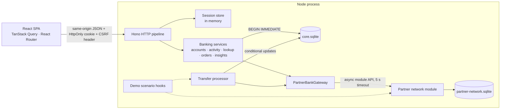

# Architecture

Part of the [technical design](README.md). Start with [System architecture](system-architecture.md) for the client/API/authentication diagram, communication sequences and physical database schemas. Feature-specific behavior lives in the feature documents; this document covers code structure, tooling and implementation policies.

## 1. Design goals

In priority order:

1. **Money correctness by construction.** The invariants in spec §7 are enforced by the database schema and a single transaction boundary, not only by service code. The client never computes authoritative balances.
2. **Honest outcomes in the UI.** Every money command resolves to exactly one of _created_, _rejected_ (definitive) or _unknown_. The client's types have no "failed" variant for a request, so an unknown outcome cannot be rendered as a failure.
3. **Clear frontend ownership.** Server state lives in TanStack Query, navigational state in the URL, unsent input in local form state. There is no global store for banking data.
4. **Testable seams.** Clock, delays, the partner network and demo faults are injected, so financial failure paths are deterministic in tests.
5. **Proportionate scope.** One Node process, two SQLite files, no external infrastructure.

## 2. Technology

| Concern     | Choice                                                                                        | Notes                                                                                               |
| ----------- | --------------------------------------------------------------------------------------------- | --------------------------------------------------------------------------------------------------- |
| Runtime     | Node.js ≥ 24.22.1 < 25 (`.nvmrc`, `engines`)                                                  | Spec §11. `npm start` runs the server with `tsx`; there is no separate server build.                |
| Language    | TypeScript, strict, `noUncheckedIndexedAccess`, `exactOptionalPropertyTypes`                  | `npm run typecheck` runs three projects; Vite only transpiles.                                      |
| Frontend    | React 19, Vite 7, React Router 7 (data router), TanStack Query 5, React Hook Form, Radix UI   | Data router for `useBlocker` (leave-wizard prompt). Radix provides Select, Dialog and AlertDialog.  |
| Validation  | Zod 4 schemas in `shared/` plus hand-written input parsers in `shared/rules/`                 | Forms call the same parsers the server uses; no form resolver library.                              |
| Styling     | Tailwind CSS 4 (`@tailwindcss/vite`), `tailwind-merge`, CSS Modules for complex styles        | Section 7.                                                                                          |
| Charts      | None; HTML/CSS bars                                                                           | Insights needs only category bars and a six-month two-series trend.                                 |
| HTTP server | Hono 4 on `@hono/node-server`                                                                 | Also serves the built SPA. The Node socket stays reachable for the `create_response_lost` scenario. |
| Database    | `node:sqlite` (`DatabaseSync`) behind a `Database` interface                                  | Release-candidate API, isolated in `server/persistence/sqlite.ts`.                                  |
| Tests       | Vitest (node + jsdom projects), React Testing Library, Playwright + `@axe-core/playwright`    | Section 8.                                                                                          |
| Tooling     | ESLint flat config (`typescript-eslint`, `jsx-a11y`, `react-hooks`), Prettier, `concurrently` | Import boundaries are lint rules (section 3.2).                                                     |

Dependencies are pinned to exact versions. One `package.json` (no workspaces); three TypeScript projects share `tsconfig.base.json`: `tsconfig.app.json` (`src/`, `shared/`), `tsconfig.server.json` (`server/`, `shared/`, `scripts/`) and `tsconfig.test.json` (everything, including tests).

## 3. Repository layout and boundaries

### 3.1 Layout

```text
shared/                 pure TypeScript used by both sides (no React, no Node APIs)
  domain/               enums.ts (domain enums), constants.ts (ordered value lists, category labels)
  schemas/api.ts        Zod schemas for requests, responses and the error envelope; inferred DTO types
  rules/                input.ts (amount, account number, reference, name parsers), command.ts (normalize/canonical
                        transfer command), policy.ts (transferLimit, transferLimitMessage, accountUsability)
  money.ts              safe-integer arithmetic, formatYen, maskAccountNumber
  time.ts               JST month/range ↔ UTC interval helpers
  errors.ts             ErrorCode, ExecutionFailureCode, HTTP status per code, field-error type
server/
  main.ts               process entry: config, lock file, static SPA + CSP, start processor, listen, shutdown
  app.ts                composition root (createDemoBankServer), shared by main.ts, tests and demo:reset
  config.ts             environment parsing
  clock.ts, lock.ts     injectable clock and random IDs; PID lock file for the CLI reset
  http/                 app.ts (pipeline), context.ts (deps, request helpers, cookies), middleware.ts, errors.ts,
                        routes/{session,banking,recipients,transfers,demo}.ts
  auth/                 password.ts (scrypt), sessions.ts (SessionStore, CSRF compare), service.ts (credentials)
  banking/              accounts, activity, transfers (order creation), processor, lookup, insights, errors
  serializers.ts        row types, the transfer view query, and row → API shape functions
  partner-gateway/      gateway.ts (PartnerBankGateway), network-gateway.ts (adapter), fake-gateway.ts (tests)
  partner-network/      mock third-party module with its own store and fixtures.json (lint-isolated)
  persistence/          sqlite.ts (driver boundary), schema.ts (DDL, reconcile)
  demo/                 catalog.ts, scenarios.ts (ScenarioEffects)
  fixtures/             definitions.ts (hand-written seed), seed.ts (deterministic generator)
src/
  main.tsx              React root
  app/                  providers, query client, router; ProtectedLayout and the application shell;
    pages/              one *Page per route, composing feature blocks
    routing/            route registry, page metadata, PageLayout, PageFrame, RouteError, lazy-page loader
  features/             accounts, activity, auth, demo, insights, transfers (wizard/, lookup/, submission/)
  shared/               api/ (HTTP client, endpoints, query keys), ui/ (primitives, Select, classes, CSS Modules),
                        routing/ (typed URL query state), navigation/ (prefetching links, deliberate-navigation bypass),
                        amounts/, format/
  styles/               tokens.css (Tailwind theme), globals.css (Tailwind import, element defaults)
tests/
  integration/          HTTP tests against the real app on temporary databases
  e2e/                  Playwright journeys against an isolated server
scripts/demo-reset.ts   CLI reset
```

Imports use `@/…` for `src/` and `@domain/…` for the root `shared/` from the browser app; the server uses relative paths. TypeScript, Vite and Vitest resolve the same aliases.

### 3.2 Import boundaries (enforced by ESLint `no-restricted-imports`)

| Files                                                                                                                                                                 | May not import                                                                                             |
| --------------------------------------------------------------------------------------------------------------------------------------------------------------------- | ---------------------------------------------------------------------------------------------------------- |
| `server/**` except the partner module, the gateway adapter (`partner-gateway/network-gateway.ts`), the composition root (`server/main.ts`, `server/app.ts`) and tests | `server/partner-network/**` (spec §8)                                                                      |
| `server/banking/**`                                                                                                                                                   | `server/http/**`, `server/demo/**` — core rules stay free of transport and demo policy                     |
| `server/**`                                                                                                                                                           | `src/**`                                                                                                   |
| `shared/**`                                                                                                                                                           | `src/**`, `server/**`, `react`, `node:*`                                                                   |
| `src/**`                                                                                                                                                              | `server/**`                                                                                                |
| `src/features/**`                                                                                                                                                     | `@/app/**`; another feature's modules except its `index.ts`. A feature imports its own modules relatively. |
| `src/shared/**`                                                                                                                                                       | `@/app/**`, `@/features/**`                                                                                |

The dependency direction in the client is therefore `app → features → shared`. A feature's `index.ts` lists exactly what other features use (for example `transfers` exports failure copy, display thresholds and the session monitor interface). Route pages in `app/pages` compose features and may import their modules directly, because `app/` is the client's composition root.

Partner codes never leave the partner module, the gateway adapter and the composition root. The demo module declares its own `PartnerFaultAdmin` vocabulary and the seed emits partner payments in domain terms; `server/app.ts` translates both into partner codes.

## 4. Shared domain module

`shared/` is the single definition of input rules, so the client's inline errors and the server's `VALIDATION_ERROR.fieldErrors` cannot drift.

- `parseAmount` accepts ASCII digits only, normalizes leading zeros, and checks the length before `Number()` so the value stays a safe integer. It never rounds or strips.
- `parseAccountNumber`, `parseReference` and `parseRecipientName` implement spec §4 _Input rules_; names are normalized to uppercase with collapsed spaces.
- `normalizeTransferCommand` applies those parsers to a structurally valid command and returns field errors keyed by the command path (`amount`, `destination.accountNumber`, …). `canonicalCommand` produces the stable JSON hashed for idempotency.
- `transferLimit(customer)` is a policy function (fixed ¥1–¥1,000,000) and `transferLimitMessage(maxMinor)` builds the customer copy from it, so the limit is stated once.
- `accountUsability(account)` derives Active/Restricted/Closed and `canSend`/`canReceive`/`canView` from lifecycle and restriction. Order creation, execution, lookup and serializers all use it.
- `time.ts` converts JST calendar months and inclusive date ranges into half-open UTC intervals `[fromMs, toMs)`. JST has no DST, so the offset is a fixed +09:00; only the server turns filters into instants.

## 5. Server



### 5.1 Composition root

`createDemoBankServer(config, options)` in `server/app.ts` wires everything explicitly (no DI container). Integration tests and `npm run demo:reset` call the same function with temporary paths, a `FakeClock` and short timings.

1. Open the core database and apply the schema; create the partner network with its own database and latency.
2. Seed both stores if the core store has no seed anchor. A populated store is never reseeded.
3. Build `NetworkGateway` (partner timeout from config).
4. When demo controls are enabled, build `ScenarioEffects` with a `PartnerFaultAdmin` adapter over the partner module.
5. Build the `TransferProcessor` (with the effects as execution hooks), the banking services (whose order creation wakes the processor), the `SessionStore` (8-hour absolute TTL) and the in-app `reset()`.
6. Build the HTTP app.

`server/main.ts` adds what only a real process needs: data directories, the PID lock file, static SPA serving with a CSP on HTML responses, `processor.start()`, listening on `127.0.0.1`, and graceful shutdown on SIGINT/SIGTERM.

Configuration (`server/config.ts`): `PORT`, `APP_ORIGIN` (comma-separated allowed origins), `DATA_DIR`, `CORE_DB_PATH`, `PARTNER_DB_PATH`, `LOCK_PATH`, `COOKIE_MODE`, `DEMO_CONTROLS`, `SERVE_STATIC`, `EXECUTION_DELAY_MS` (default 1500), `PARTNER_LATENCY_MIN_MS`/`_MAX_MS` (100/300), `PARTNER_TIMEOUT_MS` (5000). `NODE_ENV=production` disables demo controls and refuses the insecure development cookie mode.

### 5.2 HTTP pipeline

`server/http/app.ts` assembles the pipeline; each concern has its own module.

1. **Response headers** (`middleware.ts`, every path): `X-Content-Type-Options: nosniff`, `Referrer-Policy: same-origin`, `X-Frame-Options: DENY`; on `/api/*` also `Cache-Control: no-store` and one JSON log line with method, path (account numbers reduced to their last four digits), status and duration.
2. **Session guard** (`middleware.ts`, `/api/*`): load the session from the cookie, then check in this order — Origin for mutations (`403 CSRF_INVALID`), an authenticated session for everything except `GET /api/session` and `POST /api/session/login` (`401 SESSION_EXPIRED`), the session-bound `X-CSRF-Token` for mutations (`403 CSRF_INVALID`). The reasons for this order are in [Authentication](features/auth.md).
3. **Routes** (`routes/*.ts`): parse params and bodies with Zod through `parse()` (`400 VALIDATION_ERROR` with `fieldErrors` keyed by path), call a banking service, return its serialized result. Routes consume demo scenarios through `takeScenario`/`restoreScenario` in `context.ts`.
4. **Fallback**: any other `/api/*` path is `404 NOT_FOUND`.
5. **Error handler** (`errors.ts`): `DomainRejection` → its code, status and headers (for example `Retry-After`); `DatabaseBusyError` → `503 SERVICE_UNAVAILABLE`; anything else → logged, `500 INTERNAL_ERROR` with a generic message. Every error uses the envelope `{ error: { code, message, fieldErrors? } }`.

`DomainRejection` (`server/banking/errors.ts`) is the only error type that becomes a definitive rejection. It carries a default customer message per `ErrorCode`, so every route reports a code with the same words; a call site passes a message only to add specifics (a restriction reason, the customer's limit).

**Serializers** (`server/serializers.ts`) are the only place that turns rows into API shapes. They own the snapshot rule (spec §4): a counterparty carries an `accountId` only when that account is the viewer's own open account, and other customers' transfers expose only the sender's name snapshot and reference. The module sits outside `http/` because order creation stores the serialized `202` body inside its transaction, and `banking/` may not import `http/`.

In development the browser talks to the Vite server (`127.0.0.1:5173`), which proxies `/api` and forwards the original `Origin`; `npm run dev` therefore sets `APP_ORIGIN` to the Vite origins, and `npm start` uses the API origin.

### 5.3 Persistence

```ts
export interface Database {
  /** Runs fn inside BEGIN IMMEDIATE … COMMIT. fn must be synchronous (spec §7). */
  immediate<T>(fn: (tx: Tx) => NotPromise<T>): T;
  read<T>(fn: (q: Queryable) => T): T;
  exec(sql: string): void;
  close(): void;
}
type NotPromise<T> = T extends PromiseLike<unknown> ? never : T;
```

- `immediate` rejects nested transactions, asserts at runtime that the callback did not return a thenable (and rolls back if it did), and rethrows `SQLITE_BUSY`/`SQLITE_LOCKED` as `DatabaseBusyError`.
- Connection setup: `journal_mode = WAL`, `foreign_keys = ON`, `busy_timeout = 1000`, `synchronous = NORMAL`. Prepared statements are cached per SQL string.
- SQL is parameterized and lives in the banking services next to the rule that needs it; there is no separate repository layer at this size. Shared fragments are small helpers: `ACCOUNT_SQL`/`findOwnedOpenAccount`/`findBank` in `banking/accounts.ts`, `nextActivitySequence`/`resolveDateRange` in `banking/activity.ts`, `TRANSFER_VIEW_SQL` in `serializers.ts`.
- Timestamps are `INTEGER` epoch milliseconds, converted to ISO 8601 by serializers, so range filters and ordering stay numeric.

**Core schema** (`server/persistence/schema.ts`, applied with `CREATE TABLE IF NOT EXISTS`): `meta` (seed anchor), `customers`, `credentials`, `banks`, `accounts`, `transfers`, `activity`, `holds`, `idempotency_records (PRIMARY KEY (customer_id, key))`, `lookup_events`. Constraints reinforce the services:

- `accounts`: seven-digit unique `account_number`, `currency = 'JPY'`, holder name ≤ 30, `lifecycle ↔ closed_at`, `restriction ↔ restriction_reason`, `held_minor >= 0 AND held_minor <= current_balance_minor`.
- `activity`: positive amounts; `status ↔ posted_at/cancelled_at`; purchases are debits; transfer kinds use the `transfer` category; a stored generated `effective_at = COALESCE(posted_at, occurred_at)` indexed with `(account_id, effective_at, sequence)`.
- `holds`: one hold per pending entry (`activity_id UNIQUE`), `kind ↔ transfer_id`, `state ↔ resolved_at`.
- `transfers`: `destination_kind = 'external' ↔ destination_account_id IS NULL`, source ≠ destination, `status = 'failed' ↔ failure_code`, plus `source_name_snapshot` so the sender's name survives later account changes; a partial index on `next_attempt_at WHERE status = 'processing'`.

`held_minor` is the denormalized sum of active holds, maintained in the same transactions as `holds`, so `0 <= held <= current` is a `CHECK` SQLite enforces on every write; available balance is computed by serializers. `reconcile(db)` verifies `current = opening + Σ signed posted`, `held = Σ active holds`, that every active hold matches its pending debit and that no pending entry lacks a hold. It runs after seeding, in service tests and after the CLI reset.

The partner store (`partner-network.sqlite`) uses the table shapes in spec §6 and is opened only by `server/partner-network/`.

### 5.4 Seed data

`server/fixtures/definitions.ts` holds hand-written customers, accounts, banks, merchants, scheduled income, scripted transfers and holds. `server/fixtures/seed.ts` expands them into more than 300 activity entries over the 183 days before the seed anchor (the first start or the last reset) with a seeded PRNG (mulberry32), so one anchor always produces the same data and IDs. Entries are generated in chronological order, and each account's opening balance is derived backwards from its target balance so running balances never go negative. Seeding fails loudly if `reconcile()` reports a problem. The partner store is seeded from `server/partner-network/fixtures.json` plus the partner payments of the seeded external transfers.

## 6. Frontend

### 6.1 Application shell and routing

```text
<StrictMode>
  <Providers>                QueryClientProvider → PagePrefetchContext → LiveRegionProvider
    <RouterProvider router>  React Router data router built from app/routing/routes.tsx
```

| Route                    | Page                                                                               |
| ------------------------ | ---------------------------------------------------------------------------------- |
| `/login`                 | `LoginPage` (redirects to `returnTo` when already signed in)                       |
| `ProtectedLayout`        | requires a session; renders the shell: topbar, sidebar or mobile bottom navigation |
| `/`                      | `HomePage`                                                                         |
| `/accounts`              | `AccountsPage`                                                                     |
| `/accounts/:accountId`   | `AccountDetailPage`                                                                |
| `/activity`              | `ActivityPage`                                                                     |
| `/activity/:activityId`  | `ActivityDetailPage`                                                               |
| `/transfers`             | redirect → `/activity?cat=transfer`                                                |
| `/transfers/new`         | `NewTransferPage`                                                                  |
| `/transfers/:transferId` | `LegacyTransferRedirect` → `/activity/:sourceActivityId`                           |
| `/insights`              | `InsightsPage`                                                                     |
| `/menu`                  | `MenuPage` (mobile Menu tab: account pages, demo controls, log out)                |
| `*`                      | `NotFoundPage`                                                                     |

`app/routing/routes.tsx` is the single registry for paths, lazy page modules and typed `handle.page` metadata: document title, header, explicit back destination (optionally resolved from navigation state), header variant and content width. `definePage` requires an eagerly imported `Loading` skeleton and a lazy `load` function, with optional data `prefetch`; one import promise serves both hover intent and navigation, and a failed import can be retried.

- `ProtectedLayout` reads `useSession()`: while pending it shows the shell skeleton; when anonymous it redirects to `/login?returnTo=<path+search>`. `returnTo` is accepted only as a same-app path (one leading `/`), which prevents open redirects.
- `PageLayout` reads the deepest page handle, forwards the shell's outlet context and keys the outlet by pathname. During a pathname navigation it renders the destination's chrome and skeleton while keeping the current outlet mounted but hidden; search-only changes keep the page mounted. Each feature owns its loading policy: Activity retains previous rows with Updating feedback; Insights shows a skeleton for an uncached filter selection.
- `PageFrame` renders the single page bar, sets `document.title` and focuses the page `<h1>` (`tabIndex={-1}`) when the pathname changes. Route errors reuse it with error metadata (Retry and Home). A 404 from a resource renders the same neutral not-found view for "does not exist" and "not yours".
- Dynamic titles (an account or activity name) project the feature's existing query-cache entry with `cachedPageData` and `useSyncExternalStore`, without starting another request.
- `PageLink`/`PageNavLink` preload code and data on hover, focus and touch. Intent prefetch fetches protected data only when an authenticated session is already cached; prefetch errors are swallowed, and the page owns visible error and retry UI.

### 6.2 Pages, feature blocks and controllers

- Every routed screen is a `*Page` in `app/pages/`. A page renders its own JSX or composes feature blocks, and may call one controller hook for page-wide state (for example `useActivityController` for URL filters).
- Data belongs to cohesive **functional blocks**, not automatically to the page or to every visual component. A block owns its query and its loading/error/retry policy; its presentational children receive data and callbacks. On Home, `AccountsOverview` and `RecentActivitySection` own separate queries, so their pending and error states are independent.
- Home, Activity, Insights and wizard tests exercise real queries/state with a mocked API. Detail-page presentation tests also use mocked controllers. Browser journeys exercise the built app and real HTTP server.

### 6.3 HTTP client and error model

All requests go through `request()` in `src/shared/api/http.ts`; `src/shared/api/endpoints.ts` declares one typed function per endpoint with its response schema.

```ts
export type RejectedFailure = {
  kind: ApiFailureKind.Rejected; // JSON error envelope: definitive, nothing was created
  status: number;
  code: ErrorCode;
  message: string;
  fieldErrors?: FieldErrors;
  retryAfterSeconds?: number;
};
export type UnknownFailure = { kind: ApiFailureKind.Unknown; cause: UnknownFailureCause }; // timeout | network | malformed
```

- `credentials: 'same-origin'`; non-GET requests carry `X-CSRF-Token` from `csrfStore`, a module variable (not React state) set whenever the session query resolves or login returns.
- Every request combines the caller's `AbortSignal` with a 10-second timeout. A caller's abort is rethrown as-is (it is not an API outcome).
- A non-2xx response is `rejected` only if its body parses as the error envelope; anything else (a proxy page, a dropped body) is `unknown`. A 2xx body is parsed with the endpoint's Zod schema; contract drift becomes `unknown/malformed` and is logged.
- A `401` triggers the registered unauthenticated handler unless the call opts out (login, session discovery).

### 6.4 Server state

One query-key factory (`src/shared/api/keys.ts`) keeps invalidation greppable: `session`, `accounts.all/detail`, `activity.all/list/detail`, `transfers.all/detail`, `insights`, `banks`, `recipientLookup(bankId, accountNumber)`, `demoCatalog`. Feature `queries.ts` files export query-option factories shared by hooks, route prefetch and tests.

| Setting                | Value                                                                      | Reason                                                                                          |
| ---------------------- | -------------------------------------------------------------------------- | ----------------------------------------------------------------------------------------------- |
| `staleTime`            | 15 s; banks and session `Infinity`; activity detail and lookup per feature | Avoid refetch storms while navigating; freshness comes from focus refetch and explicit refresh. |
| `refetchOnWindowFocus` | `true`                                                                     | Changes made in another tab eventually appear (spec §11).                                       |
| `retry`                | reads: once, only for `unknown`; never for `rejected`. Mutations: none     | Transfer submission has its own retry policy ([Transfers](features/transfers.md)).              |

Balances are never optimistically updated. Banking query functions forward abort signals where supported. Logout and reset cancel queries and clear their cache so cancelled reads cannot repopulate customer data. The invalidation rules after a transfer are described in [Transfers](features/transfers.md).

**Transfer synchronization:** `app/query-client.ts` installs one session monitor per QueryClient. The React-independent implementation in `features/transfers/monitor.ts` owns pending-order discovery, status polling, backoff and cache invalidation; `monitor-runtime.ts` binds it to authenticated session/cache events and browser visibility/connectivity. Submission registers an order before returning to the UI. Screens only read queries; navigation does not affect tracking. Active balances refresh on terminal outcomes even on routes without activity UI. See [Transfers](features/transfers.md#session-owned-transfer-tracking).

**Session cleanup:** `clearCustomerData(queryClient)` in `features/auth` stops and aborts transfer monitoring, cancels queries, clears the cache and blanks the module-local CSRF token. Logout, the global 401 handler and demo reset then navigate to login, unmounting the protected route tree. Wizard drafts, review snapshots and idempotency keys are React-local state and disappear on that unmount. `navigationBypass` in `shared/navigation/bypass.ts` lets these deliberate navigations pass the wizard's leave prompt.

### 6.5 URL state

Activity and Insights keep their filters in the URL through `useQueryParams(model)` (`src/shared/routing/useQueryParams.ts`). A model, defined with `defineQueryModel`, supplies:

- a Zod object schema of scalar fields; each invalid parameter falls back to its default instead of failing the page, so a hand-edited URL never crashes;
- `defaults()`, evaluated at use time (Insights' default month follows the current JST month); default values are omitted from URLs;
- optional `normalize(values)` for relationships between fields, applied on read and write (Activity prefers a valid `from/to` pair over `month`);
- optional `beforeWrite(next, { patch })` for update rules (Activity resets `page` to 1 unless the patch sets it);
- `unknownParams`: `drop` (Activity) or `preserve` (Insights).

The setter accepts `(patch, { replace? })`: omitted keys keep their values, `undefined` removes a field or resets it to its default. Reading never rewrites the URL. `parseQueryParams`, `serializeQueryParams` and `updateQueryParams` expose the same behavior as pure functions for route prefetch and tests.

## 7. Styling

- **Tokens.** `src/styles/tokens.css` is the Tailwind `@theme` and the single source of design tokens (spec §5). Tailwind's default palette, type scale, radii, containers and breakpoints are cleared, so only design-system values exist as utilities: `bg-canvas`, `text-muted`, `border-row-divider`, `text-md` (14 px), `max-md:`. Spacing is a 4 px unit in px (`p-4` = 16 px) for parity with the design canvas. Each token is also a CSS variable (`--color-canvas`, `--text-md`) for CSS Modules. Tokens are named `ink`/`muted`/`disabled` rather than `text`/`text-muted`/`disabled-bg`, so utilities read `text-ink`, not `text-text`.
- **Utilities by default.** Styles are Tailwind utilities in JSX. Class lists repeated across pages (content widths, card, buttons, inputs, tabs, filters, status text, dialog) are named in `src/shared/ui/classes.ts` and used as `className={ui.card}`; there are no global component classes and no runtime CSS-in-JS.
- **Composition with `tailwind-merge`.** `classes.ts` exports `twMerge`, configured with the custom theme groups (`text-md`, `spacing-touch`, `container-page`, `shadow-dialog`, …). Shared lists are composed with variants or call-site overrides through `twMerge(ui.btnPrimary, 'w-full')`, so a later utility for the same property wins regardless of class order. `classes.test.ts` checks that the custom groups merge correctly.
- **CSS Modules for complex styles only**: rules over children the component does not class (`shared/ui/table.module.css`, `dl.module.css`, `select.module.css`), multi-element responsive re-layouts (the Home account rows in `accounts.module.css`, the review rows in `wizard.module.css`), selectors such as `:has(input:checked)` (the wizard radio option), and custom drawing (`insights.module.css` charts, the wizard stepper). Module rules are unlayered and therefore outrank utilities, so a module-styled property is not also restyled with a utility on the same element. Inline `style` is used only for computed values such as bar lengths.
- `globals.css` imports Tailwind (scanning `src/` only), declares element defaults in `@layer base` (including `svg { display: inline }`) and the reduced-motion rule. Noto Sans 300–600 is loaded from Google Fonts in `index.html`, with a system fallback.
- **Breakpoints.** `max-md:` (< 810 px) is the phone layout: the shell switches from the sidebar to the bottom navigation, which respects `env(safe-area-inset-bottom)`. `max-lg:` (< 1101 px) and `max-xl:` (< 1200 px) collapse multi-column layouts. CSS Modules use the same widths.

## 8. Accessibility

- Semantic structure: one `<h1>` per page focused on navigation, a skip link in the shell, labeled landmarks.
- Radix `Select`, `Dialog` and `AlertDialog` provide keyboard operation, focus trapping, Escape and focus return. All selects use `shared/ui/Select.tsx` (controlled values, custom option content, typeahead); empty choices (All accounts, All, None) are encoded internally so they stay selectable.
- Inputs are at least 44 px high, labeled, and wired with `aria-describedby` to their hint and `FieldError`, plus `aria-invalid`. Wizard input-step validation focuses the first invalid field; `FieldError` uses `role="alert"`.
- Announcements go through one polite live region (`shared/ui/live-region.tsx`): transfer progress, status changes, copy confirmations.
- Status is shown as text plus icon, never color alone; money uses `tabular-nums`; `prefers-reduced-motion` disables skeleton animation and transitions.
- `eslint-plugin-jsx-a11y` runs in lint; Playwright runs axe on each main page.

## 9. Testing strategy

| Layer                          | Location                           | Focus                                                                                                                                                            |
| ------------------------------ | ---------------------------------- | ---------------------------------------------------------------------------------------------------------------------------------------------------------------- |
| Unit (Vitest, node)            | `shared/**/*.test.ts`              | Input rule matrix (AC-08), JST month boundaries.                                                                                                                 |
| Service (Vitest, temp SQLite)  | `server/banking/transfers.test.ts` | Order rules and boundary amounts with holds, replay after state change, conditional transitions, processor with `FakeGateway` and `FakeClock`, `reconcile()`.    |
| HTTP integration               | `tests/integration/http.test.ts`   | Real `createDemoBankServer` on temporary databases: cookies and rotation, Origin/CSRF/401 order, cross-customer 404s, `Retry-After`, restart resumes processing. |
| Component (Vitest, jsdom, RTL) | `src/**/*.test.tsx`                | Wizard steps, lookup interactions, submission retry, polling, pages with mocked controllers or API, URL query models, `Money`.                                   |
| E2E (Playwright, 1 worker)     | `tests/e2e/*.spec.ts`              | Own/internal/external journeys, demo scenarios, keyboard-only transfer, 320/810/1440 px layouts, axe.                                                            |

E2E builds the app and starts an isolated server on port 8788 with its own `.e2e-data/` databases, `EXECUTION_DELAY_MS=400` and 0–20 ms partner latency; data is reset before each test through the demo reset endpoint. No test touches `data/`. Coverage percentage is not a target.

## 10. Risks and mitigations

| Risk                                                         | Mitigation                                                                                                     |
| ------------------------------------------------------------ | -------------------------------------------------------------------------------------------------------------- |
| `node:sqlite` API changes within Node 24                     | Isolated in one file behind `Database`; every integration test exercises it.                                   |
| An `await` slipping into a write transaction                 | `NotPromise<T>` in the type of `immediate` and a runtime thenable check that rolls back.                       |
| Timer-heavy logic (polling, retries, backoff) becoming flaky | Injected clock, random source and sleep on both sides; E2E uses short configured delays.                       |
| A new Home element showing an unmasked amount                | Every amount renders through `<Money>`; an E2E check scans Home's DOM while hidden.                            |
| Dev server restarts clearing sessions                        | Expected (sessions are in memory); documented in the README.                                                   |
| `Origin` mismatch behind the Vite proxy                      | `APP_ORIGIN` per mode, accepting both `127.0.0.1` and `localhost`; an integration test rejects a wrong origin. |
| Partner codes leaking into core or demo code                 | Lint boundary plus translation in the composition root.                                                        |
