# Transfers — technical design

Part of the [technical design](../README.md). Decision record: [ADR 0002](../../adr/0002-money-and-transfer-consistency.md). Recipient lookup has its own document: [Recipient lookup](recipient-lookup.md).

## 1. Scope

Transfers to own accounts, to another customer of the demo bank, and to an account at a partner bank: atomic order creation with idempotency, asynchronous execution by an in-process processor, the partner network behind a gateway, the four-step wizard with safe submission, and live status tracking in Activity Details (spec §4 _New transfer_, _Input rules_; §7; §8; §10 _Transfer command_; AC-05–AC-10).

## 2. Code map

| Side   | Module                                              | Responsibility                                                                                                             |
| ------ | --------------------------------------------------- | -------------------------------------------------------------------------------------------------------------------------- |
| Shared | `shared/rules/command.ts`, `input.ts`, `policy.ts`  | Command normalization and canonical form; input parsers; transfer limit and its message; account usability.                |
| Server | `server/http/routes/transfers.ts`                   | `POST /api/transfers`: idempotency header, schema and input rules, demo scenario consumption, response headers.            |
| Server | `server/banking/transfers.ts`                       | `createOrder` (pre-resolution, fixed rejection order, one write transaction), `get`, `list`.                               |
| Server | `server/banking/processor.ts`                       | `TransferProcessor`: scheduling, internal and external steps, conditional state transitions, hooks.                        |
| Server | `server/partner-gateway/`                           | `PartnerBankGateway` interface, `NetworkGateway` adapter (timeouts, code mapping), `FakeGateway` for tests.                |
| Server | `server/partner-network/`                           | The mock third party: its own SQLite store, latency, fault policy.                                                         |
| Client | `src/features/transfers/wizard/`                    | The wizard: form root, flow, steps, draft (review snapshot + key), rejection mapping, leave guard.                         |
| Client | `src/features/transfers/submission/submit.ts`       | `submitTransfer`: bounded retries on unknown outcomes; React-independent.                                                  |
| Client | `commands.ts`, `monitor.ts`, `monitor-runtime.ts`   | Register accepted orders before returning to UI; session-owned polling, discovery, cancellation and cache synchronization. |
| Client | `src/features/transfers/polling.ts`, `messages.ts`  | Status polling schedule; customer copy for failures and rejections (exported through `index.ts`).                          |
| Client | `src/features/transfers/TransferDetailsSection.tsx` | Transfer Details inside Activity Details: status, explanations, order fields, recovery actions.                            |
| Client | `LegacyTransferRedirect.tsx`                        | `/transfers/:id` → source Activity Details.                                                                                |
| Pages  | `NewTransferPage` (+ `useTransferEntryController`)  | Loads accounts, banks and the session's limit, then renders `TransferWizard`.                                              |

## 3. API

**`POST /api/transfers`** — header `Idempotency-Key` (UUID); body:

```ts
type TransferCommand = {
  sourceAccountId: string;
  destination:
    | { kind: 'own'; accountId: string }
    | {
        kind: 'recipient';
        bankId: string;
        accountNumber: string;
        recipientName: string;
        recipientNameSource: 'lookup' | 'manual';
      };
  amount: string; // ASCII digits only
  reference?: string;
};
```

`202 Accepted` with the `Transfer` (including `sourceActivityId`), `Location: /api/transfers/:id`, and `Idempotent-Replayed: true` on a replay. Every other answer is the error envelope and means no order was created.

**`GET /api/transfers/:id`**, **`GET /api/transfers`** (owned outgoing orders with search, status, source, date range and paging) are kept for API consumers and legacy URL resolution; the UI tracks transfers through Account activity.

A `Transfer` carries `id`, `status`, `failureCode`, `delayedSince`, timestamps, `amountMinor`, `reference`, `destinationKind`, `source { accountId?, name, maskedNumber }` and `destination { name, nameSource, bank, maskedNumber, accountId? }`, where an `accountId` appears only for the viewer's own open accounts.

## 4. Design

### Order creation

`createOrder(customerId, key, normalizedCommand, opts)`:

1. **Outside any transaction**, if the destination is a recipient at a partner bank, call `gateway.inquire` once. The result is `found`, `not_found`, `cannot_receive` or `unresolved` (partner unavailable). This inquiry does not count toward the lookup limit.
2. **One `BEGIN IMMEDIATE` transaction** (synchronous; no network, waits or `await`):
   1. Purge this key's expired record, then look up `(customerId, key)`. Same request hash → return the stored response (`replayed`). Different hash → `422 IDEMPOTENCY_KEY_REUSED`. This precedes every business check, so a replay returns the original result even if account state has changed since.
   2. Apply the rules in one fixed order: `NOT_FOUND` (source not an owned open account) → `SOURCE_UNAVAILABLE` (with the restriction reason) → `SAME_ACCOUNT` → `RECIPIENT_NOT_FOUND` → `DESTINATION_UNAVAILABLE` → `TRANSFER_LIMIT_EXCEEDED` (message from `transferLimitMessage`) → `INSUFFICIENT_FUNDS` (amount > current − held).
   3. Resolve the destination: an `own` destination must be another owned open account; a `recipient` at the host bank resolves by account number and becomes `own` when that account belongs to the customer, otherwise `internal`; a partner-bank recipient is `external` and is rejected only when pre-resolution said `not_found`/`cannot_receive`. The recipient name is never compared here, so a rejection never confirms or denies a guessed name.
   4. Insert the transfer (`processing`, `next_attempt_at = now + delay`, `demo_scenario`), the pending `transfer_out` source entry (next `sequence`), the transfer hold, and `held_minor += amount`. The `held_minor <= current_balance_minor` CHECK makes overspending impossible to commit, including from concurrent tabs.
   5. Store the idempotency record (request hash, `202`, serialized body, 24 h expiry) and delete the customer's lookup events.
3. After commit, wake the processor.

Notes:

- The request hash is SHA-256 of `canonicalCommand`: normalized name and its source, `amountMinor` as a number, reference absent when empty.
- Any rejection rolls back, so no idempotency record is stored and a later request with the same key is evaluated afresh.
- `SQLITE_BUSY` beyond the busy timeout surfaces as `503 SERVICE_UNAVAILABLE` before anything commits.
- The first attempt is scheduled after `EXECUTION_DELAY_MS` (1.5 s) for own/internal orders so Processing is visible, and immediately for external orders; `execution_slow` overrides the delay.
- Expired idempotency records are also purged on every processor tick.

### Transfer processor

A single in-process worker; at most one step runs at a time. `tick()` purges expired idempotency records, runs the earliest due transfer (`status = 'processing' AND next_attempt_at <= now`), then schedules itself for the next due time, capped by a 5 s fallback so a missed wake-up cannot stall processing. `start()` resumes all processing transfers after a restart; `stop()` waits for the in-flight step (used by reset and shutdown); `drain()` runs due steps synchronously for tests.

Every state change is `UPDATE … WHERE id = ? AND status = 'processing'` and checks that exactly one row changed, so running a step twice cannot double-apply it.

```mermaid
stateDiagram-v2
    [*] --> Processing: order created (hold active, entry pending)
    Processing --> Completed: internal ok / partner settled (capture hold, post entries)
    Processing --> Failed: account unusable, name mismatch, partner rejected, injected failure (release hold, cancel entry)
    Processing --> Processing: partner outcome unknown (inquire with backoff; Delayed after 2 min)
```



**Own and internal** — one transaction re-reads the transfer and both accounts. Failure in this order: injected failure → `PROCESSING_FAILED`; source cannot send → `SOURCE_UNAVAILABLE`; destination cannot receive → `DESTINATION_UNAVAILABLE`; for `internal`, normalized `recipient_name_snapshot` ≠ destination holder name → `RECIPIENT_NAME_MISMATCH`. Otherwise complete: mark Completed, capture the hold and post the source entry (`current −= amount`, `held −= amount`), insert a posted `transfer_in` credit on the destination linked by `transfer_id`, and `current += amount` there. Combined balance is conserved.

**External** — the next action is derived from stored fields, so restart behavior needs no extra state:

| `execution_attempts` | Action                                                                                                                                                                       |
| -------------------- | ---------------------------------------------------------------------------------------------------------------------------------------------------------------------------- |
| `0`                  | In a transaction: check the injected failure and that the source can still send (else fail); record `attempts = 1` and the next attempt time; commit. Then `gateway.submit`. |
| `> 0`                | Record `attempts + 1` and the next attempt time; commit. Then `gateway.inquireTransfer`; on `not_received`, `submit` again with the same transfer ID.                        |

- `settled` → one transaction: mark Completed, store `partner_payment_id`, capture the hold and post the source debit. `rejected` → fail with the mapped code. `UnknownOutcomeError` (timeout, transport error) → stays Processing; it is never marked Failed.
- A crash between recording the attempt and submitting leaves `attempts = 1` with nothing sent; the next step inquires, gets `not_received`, and submits. This is "resume with an inquiry, never a blind resend".
- Wait after attempt _n_: 2, 4, 8, 16 s, then 30 s. Once the transfer is older than 2 minutes, `delayed_since` is set and inquiries run every 60 s until a definitive answer.
- The source's eligibility is checked only before the first submission. Once the payment may have reached the partner, the partner's answer decides.

**Execution hooks.** The processor receives `ExecutionHooks { beforeExecute(transfer), injectFailure(transfer) }`, a no-op by default. `ScenarioEffects` implements them from the scenario recorded on the transfer ([Demo controls](demo-controls.md)); core rules never branch on scenario names.

### Partner gateway and network

```ts
export interface PartnerBankGateway {
  inquire(bankCode: string, accountNumber: string): Promise<InquiryOutcome>; // found | not_found | cannot_receive | unavailable
  submit(req: CreditTransferRequest): Promise<PartnerResult>; // throws UnknownOutcomeError when the outcome is unknown
  inquireTransfer(transferId: string): Promise<PartnerResult | { kind: 'not_received' }>; // throws UnknownOutcomeError
}
type PartnerResult =
  { kind: 'settled'; paymentId: string } | { kind: 'rejected'; failureCode: ExecutionFailureCode };
```

- `NetworkGateway` races every call against a timer (`PARTNER_TIMEOUT_MS`, 5 s). It is the only code that knows partner field names and codes: `status_cd 2/9` → `cannot_receive`; `result_cd E1/E2/E9` → `DESTINATION_REJECTED`, `E3` → `RECIPIENT_NAME_MISMATCH`, `E4` → `RECIPIENT_NOT_FOUND`. An inquiry failure or timeout maps to `unavailable`.
- The partner module exposes `inquireAccount`, `submitCreditTransfer` (verifies status and compares the normalized beneficiary name, records the payment, idempotent by `client_ref`) and `getCreditTransfer` (the record or `NOT_RECEIVED`), each with 100–300 ms simulated latency. A bank with `inquiry_available = 0` refuses inquiries.
- Its admin API applies a per-payment fault looked up by `client_ref` — answer after a delay beyond the timeout once committed, lose the first submission, refuse calls until a time, or reject — so "the partner recorded the payment but the response was lost" is a real state in the partner store, not a mocked return value.
- `FakeGateway` is an in-memory, scriptable implementation for service tests.

### Wizard (client)

```text
TransferWizard
  └─ TransferFormRoot          one React Hook Form instance + FormProvider, defaults initialized once
       └─ TransferFlow
            ├─ useTransferWizard       current step, server step error, goTo, openReview, definitive results
            │    └─ useTransferDraft   review snapshot and idempotency key
            ├─ TransferProgress, SourceSummary
            ├─ SourceStep | DestinationStep | AmountStep     (only the current step is mounted)
            ├─ ReviewController → useTransferSubmission → ReviewStep
            └─ LeaveGuardController   dirty state, route blocker, leave dialog
```

```tsx
<SourceStep onNext={() => goTo(TransferStep.Destination)} />
<DestinationStep onNext={() => goTo(TransferStep.Amount)} />
<AmountStep onNext={openReview} />
<ReviewController onResult={handleSubmissionResult} onEdit={goTo} onCreated={onCreated} />
```

- **Steps own validation; the wizard owns navigation.** Each step validates with local functions (`validateSource`, `validateDestination`, `validateAmount`) built on the shared parsers, sets its field errors, clears the wizard's server error (`onAttempt`), and calls `onNext` when complete. Steps read errors with a field-scoped `useFormState` and values with `useWatch`, so field edits, lookups, submission phases and dialog updates do not re-render sibling components.
- **Defaults** (`TransferFormRoot`): a route-state `prefill` (corrected transfer) wins over `?from=<accountId>` (account-detail entry, accepted only for an account that can send). With a preselected source the wizard opens at **To**, with a summary bar and a Change link.
- **Destination**: Own accounts lists the customer's other accounts, unusable ones visible but disabled with the reason; Someone else runs the recipient lookup ([Recipient lookup](recipient-lookup.md)). The form stores `recipientName` and `recipientNameSource` (`lookup`/`manual`, `null` until accepted).
- **Amount** shows the source's available balance, the limit and zero fee; it pre-checks the amount against the limit (`transferLimitMessage`) and the available balance for inline errors. The server remains authoritative.
- **Review** shows the immutable snapshot: source, destination, bank, recipient name and whether it was registered at the bank or entered by the customer, amount, zero fee, reference and the resulting available balance. Change links return to a step without discarding other fields.
- `buildTransferCommand(values)` reads only form values and refuses a recipient whose name source was never accepted.
- Every step focuses its heading on mount (`useStepHeadingFocus`); Review also focuses the unknown-outcome heading each time it enters that state.

### Review snapshot and idempotency key

| Event                                                                      | Policy                                                                                                                                                        |
| -------------------------------------------------------------------------- | ------------------------------------------------------------------------------------------------------------------------------------------------------------- |
| Enter Review                                                               | Build the command; keep the existing snapshot and key if the command is unchanged, otherwise a new `crypto.randomUUID()` (generated outside a state updater). |
| Any form value changes while a snapshot exists                             | Invalidate the snapshot; the next Review gets a new key.                                                                                                      |
| Automatic retry, or Try again after unknown                                | Same snapshot, same key; Confirm never rebuilds the command from the form.                                                                                    |
| Rejection that returns to Source/Destination/Amount                        | Invalidate the snapshot.                                                                                                                                      |
| Rejection that stays on Review (`IDEMPOTENCY_KEY_REUSED`, `503`, unmapped) | Keep the command, renew the key.                                                                                                                              |
| `401`                                                                      | Global handler; the draft is discarded with all client state.                                                                                                 |
| Created, wizard unmount, logout                                            | Discard the snapshot; the key is never written to storage or the URL.                                                                                         |

### Submission

`submitTransfer(send, opts)` sends the order and retries only on `unknown` failures, up to two more attempts after 1 s and 3 s with ±20 % jitter, always with the same key and body. `random` and `sleep` are injectable for tests. Its result is `created | rejected | unknown`; there is no "failed" variant.

`useTransferSubmission` (mounted only while Review is) guards against double confirmation with an in-flight ref, before React renders the disabled button; announces "Submitting transfer…" / "Still trying to reach the bank…"; and aborts on unmount.

| Result         | UI                                                                                                                                                                                                                                                                                                                   |
| -------------- | -------------------------------------------------------------------------------------------------------------------------------------------------------------------------------------------------------------------------------------------------------------------------------------------------------------------- |
| `created`      | `submitTransferOrder` registers the order with the session monitor and refreshes related caches before returning. Mark the order created (bypasses the leave guard), announce, and navigate with `replace` to `/activity/:sourceActivityId` with `{ justCreated, backTo: '/activity?cat=transfer' }`.                |
| `rejected` 400 | `mapTransferRejection` maps `fieldErrors` paths to form fields and goes to the step that owns the first one.                                                                                                                                                                                                         |
| `rejected` 422 | Go to the owning step with the reason: `INSUFFICIENT_FUNDS`/`TRANSFER_LIMIT_EXCEEDED` → Amount (also as the amount field error); `SOURCE_UNAVAILABLE`/`NOT_FOUND` → Source; `DESTINATION_UNAVAILABLE`/`SAME_ACCOUNT`/`RECIPIENT_NOT_FOUND` → Destination; `IDEMPOTENCY_KEY_REUSED` → stays on Review with a new key. |
| `rejected` 503 | Stay on Review with the reason and Try again (new key, since nothing was recorded).                                                                                                                                                                                                                                  |
| `rejected` 401 | Global handler → login.                                                                                                                                                                                                                                                                                              |
| `unknown`      | "We couldn't confirm your transfer" with **Try again** (same key) and **View account activity** (`/activity?cat=transfer`); the copy tells the customer to check activity before submitting again.                                                                                                                   |

Customer copy for rejections and execution failures lives in `messages.ts`. For `SOURCE_UNAVAILABLE` and `TRANSFER_LIMIT_EXCEEDED` the wizard shows the server's message, which carries the restriction reason or the customer's limit.

**Leaving the wizard.** `LeaveGuardController` blocks route changes with `useBlocker` and covers reloads with `beforeunload` when the form is dirty or the customer has moved past the initial step, unless an order was created or a deliberate navigation (logout, 401, reset) set the bypass. The dialog (Radix `AlertDialog`) offers Keep editing / Leave. The step lives in component state, not the URL, because a reload cannot restore the draft.

### Session-owned transfer tracking

`monitor.ts` owns tracking independently of React and the router. `monitor-runtime.ts` keeps one monitor per `QueryClient`; `app/query-client.ts` installs its session/cache and browser-event subscriptions once. Route changes, mounting, and unmounting do not start or stop polling.

- An authenticated session starts discovery using every page of `GET /api/transfers?status=processing&pageSize=100`, without month, account or UI filters. Login and full reload therefore recover pending orders. Discovery failures retry after 15 seconds; disappearance from a discovery result is never inferred to mean success or failure.
- `commands.ts` wraps submission. Before returning an accepted order to the UI, it registers it with the monitor and invalidates accounts/activity/transfers/insights because the hold changed available balance. A result from an aborted or replaced session cannot register an order in a later session.
- The runtime also notices Processing IDs in successful activity/transfer cache reads, covering orders discovered through other reads. Historical Completed/Failed entries do not trigger tracking or balance invalidation.
- One scheduler tracks all known pending IDs, with at most one status read in flight per ID. It reads `GET /api/transfers/:id` immediately after registration, then uses `nextPollInterval`: roughly 1 second for the first 10 seconds, then 2/4/8 seconds capped at 15 seconds, and 30 seconds after 2 minutes (all ±20% jitter). Read failures keep Processing and retry; they never fabricate Failed.
- Hidden/offline tabs pause scheduling. Visibility, focus and reconnect trigger immediate checks of known IDs and rediscovery. Completed/Failed removes the ID from scheduling; terminal IDs are remembered for the session so stale Processing responses cannot restart them.
- Status reads update the transfer cache. A terminal outcome cancels older dependent reads and invalidates accounts, activity, transfers and insights: active queries refetch, inactive queries become stale. Cancelling also covers initial reads without cached data, so a response captured before settlement cannot overwrite the outcome. A change to `delayedSince` refreshes activity. This works on balance-only routes with no activity or transfer UI mounted.
- Logout stops the monitor before the request; session removal, global 401 and demo cleanup also stop it. Stopping aborts discovery/status requests, clears timers/IDs and rejects late responses using the session identity. No monitor state is persisted in browser storage.

The module tracks known outgoing transfers in the current tab. It is not a general account-change feed: an unrelated incoming payment, or a transfer created and completed entirely on another device before discovery, still relies on ordinary account reads/refresh. A customer revision or server event feed would be needed for that broader guarantee. There is no cross-tab leader election; each authenticated tab has its own monitor.

### Status tracking on Activity Details

`useActivityDetailController` only reads the activity query and owns presentation: elapsed-time display, focus and announcements. It has no status polling timer or cache-invalidation effect. After 2 minutes it explains that checks continue less frequently and offers **Check again**, which asks the shared monitor for an immediate read. The display clock does not alter the monitor schedule.

`TransferDetailsSection` explains the state: received and reserved; "Taking longer than usual" after 10 s; **Delayed** ("hasn't confirmed yet… has not failed, and it won't be sent twice") when `delayedSince` is set; the completion summary; or the failure reason with "Your money was not moved — the hold has been released". It lists the permitted order fields and offers Account activity plus **Make another transfer** (completed), the failure's action with a corrected-transfer prefill (failed), or Back to Home (processing). The prefill carries source, own destination or bank, amount and reference — never the account number, because only its masked form is exposed. For an incoming transfer from another customer the section shows only the sender and reference.

Home, Activity list and Activity Details read their normal queries; the session monitor owns transfer-driven synchronization. No screen needs an outcome-refresh hook.

## 5. Errors and edge cases

| Situation                                           | Behavior                                                                                      |
| --------------------------------------------------- | --------------------------------------------------------------------------------------------- |
| Double click on Confirm                             | In-flight ref ignores the second click; one request.                                          |
| Response lost after commit (`create_response_lost`) | Network error → unknown → retry with the same key → replay → one order.                       |
| Response slower than the 10 s client timeout        | Timeout → unknown → retry → replay.                                                           |
| Same key, changed payload                           | `422 IDEMPOTENCY_KEY_REUSED`; Review renews the key.                                          |
| Account restricted/closed after the order           | Failed with `SOURCE_UNAVAILABLE` / `DESTINATION_UNAVAILABLE`; hold released, entry cancelled. |
| Partner timeout after recording the payment         | Stays Processing; the next inquiry finds it settled → Completed exactly once.                 |
| Partner never received the payment                  | Inquiry `not_received` → resubmitted with the same transfer ID → Completed.                   |
| Partner outage                                      | Processing, then Delayed after 2 minutes; completes when the outage ends.                     |
| Server restart mid-processing                       | `start()` resumes; external transfers start with an inquiry.                                  |
| Wrong manual name for a partner account             | Order created; partner `E3` → Failed `RECIPIENT_NAME_MISMATCH`, hold released.                |
| `401` while polling                                 | Login; processing continues server-side and the outcome is visible in activity after sign-in. |

## 6. Design choices

- **Order creation separate from execution** (ADR 0002): an external call never runs inside a database transaction, and a timeout cannot leave money half-moved. Funds are reserved at creation, so execution cannot fail for insufficient funds.
- **Fixed rejection order** in one function, so the client can rely on it (for example `SAME_ACCOUNT` before `INSUFFICIENT_FUNDS`).
- **A recipient that resolves to the customer's own account is `own`**, with the normal lookup flow; there is no separate "own account" lookup outcome.
- **An own-account destination ID that is not an owned open account is `RECIPIENT_NOT_FOUND`**; a restricted own account is `DESTINATION_UNAVAILABLE`.
- **Next external action derived from `execution_attempts`** instead of a separate state column.
- **Invalidate at order creation as well as at terminal status**, because the transfer hold changes available balance immediately. The session monitor owns both events, independent of the current route.
- **422 rejections return to the step that owns the cause; 503 stays on Review**, so the customer fixes the input where it was entered.
- **Wizard: step ownership with wizard navigation.** Validation and interactions live next to their UI; the flow's callbacks show the order of steps in one place; state that must survive step unmounts (form values, review snapshot and key) lives above the steps.
- **Client pre-checks** the limit and available balance for fast inline errors; nothing on the client is trusted.

## 7. Tests

- `server/banking/transfers.test.ts`: reserve then post with conserved balance; own-account classification of a recipient; amount boundaries with holds and at the limit; rejections record nothing; `SAME_ACCOUNT` before `INSUFFICIENT_FUNDS`; no name comparison at creation; idempotent replay, payload mismatch, replay after state change, per-customer keys; source restricted after the order; external completion, name mismatch, unknown outcome settled once after inquiry, resend after not received, Delayed not Failed; a stale step cannot double-post.
- `tests/integration/http.test.ts`: idempotency header validation, create and replay over HTTP; demo scenarios for recipient closure (internal and external) and pending scenarios on replay; restart resumes without double posting; completion through the real partner module.
- `src/features/transfers/monitor.test.ts`, `monitor-runtime.test.ts`: balance-only query updates, first-read terminal results, multiple transfers, paginated recovery, duplicate registration, retries past two minutes, pause/resume, session aborts, late/stale responses, and registration before returning from submission.
- `src/features/transfers/submission/submit.test.ts`, `polling.test.ts`, `wizard/transfer-rejection.test.ts`: retry and jitter schedule; unknown never becomes failed; polling intervals; rejection mapping.
- `src/features/transfers/wizard/NewTransferPage.test.tsx`: steps, review invalidation and key policy, double confirm, unknown panel and retry, rejection recovery, render isolation of the progress and source summary, leave guard, first-invalid-field focus and announced validation errors.
- `tests/e2e/journeys.spec.ts`: keyboard-only own-account transfer; external transfer with a looked-up name, and a wrong manual name failing with the hold released; recipient closure; order rejection returning to the owning step; lost response creating exactly one order.
- `tests/e2e/transfer-monitor.spec.ts`: Confirm then immediately open a balance-only route; the balance updates without activity UI, including after a full reload.
