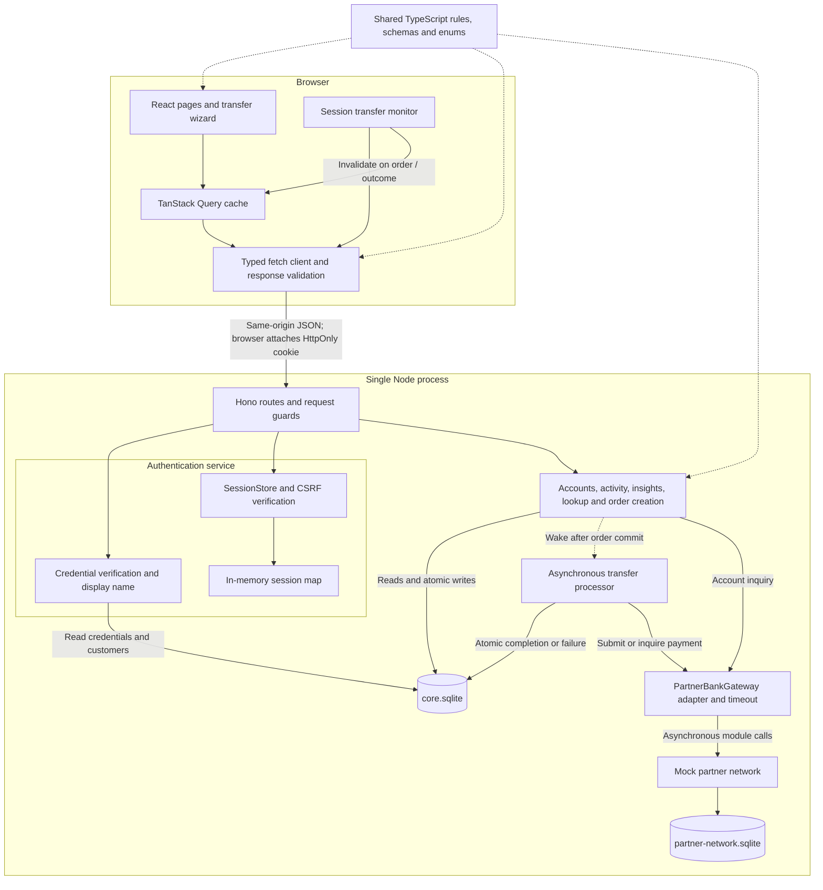
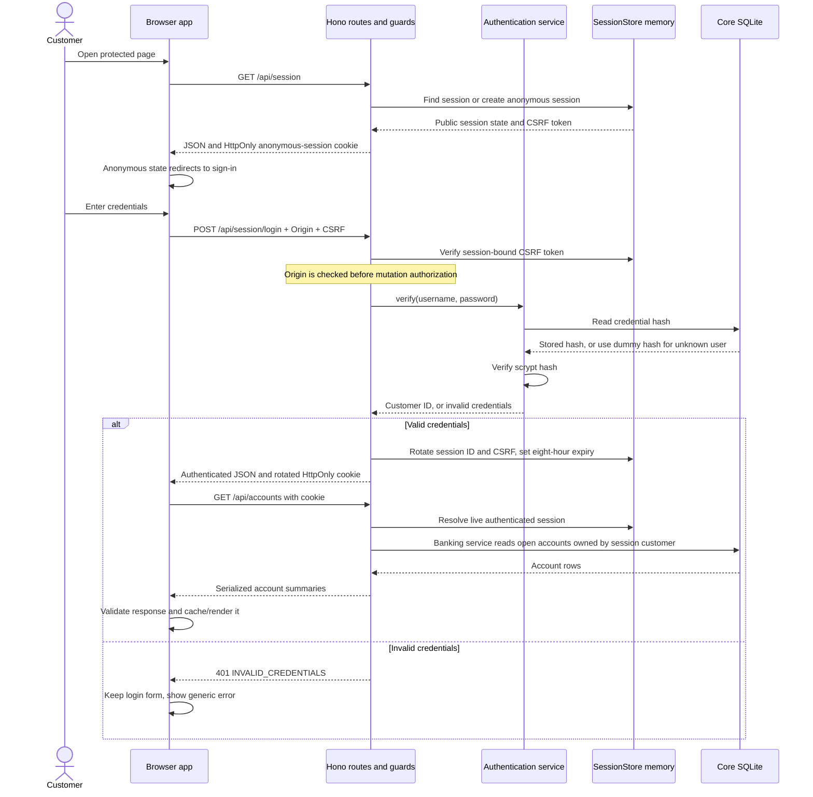
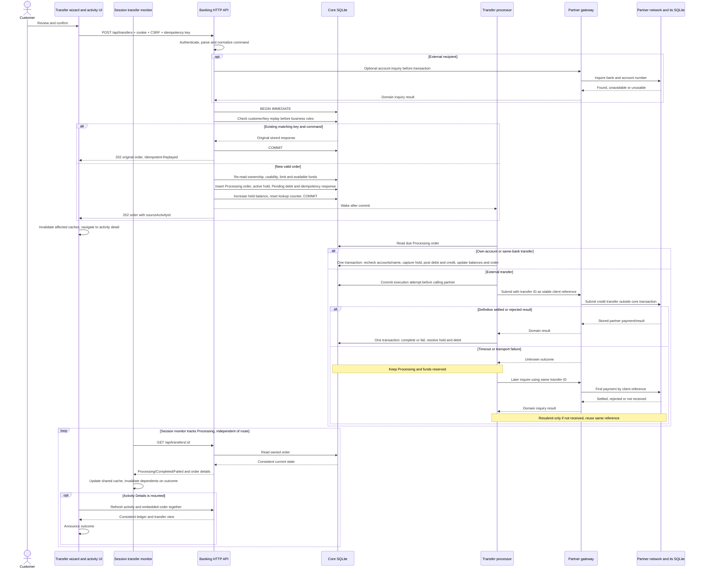
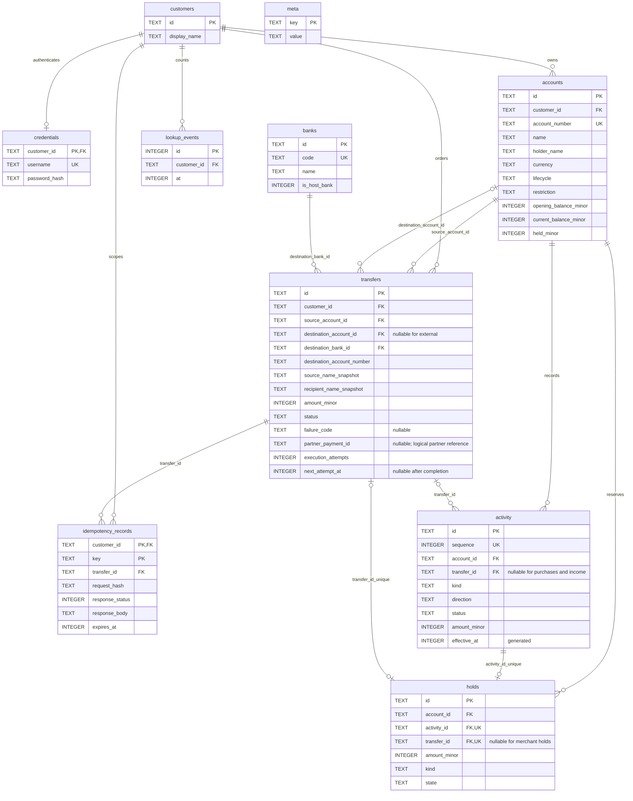
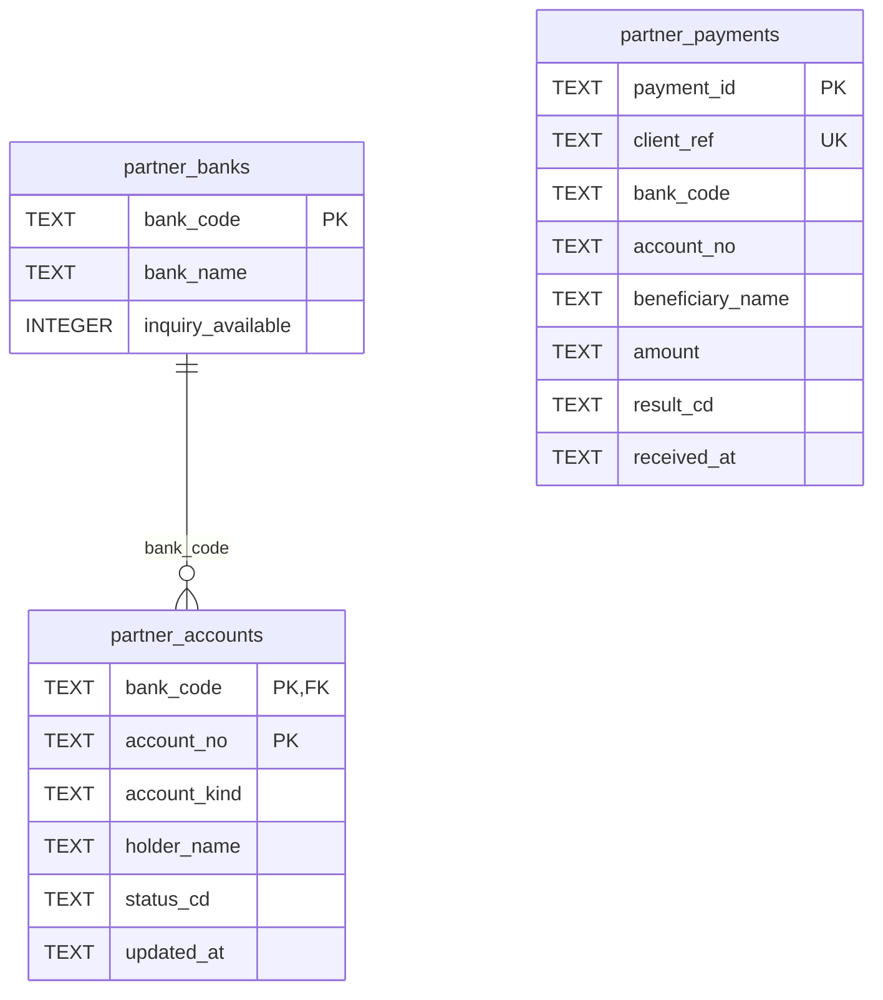

# System architecture

This document maps the implemented client, banking API, authentication service and databases, then follows their communication during sign-in, reads and transfers. [Implementation architecture](architecture.md) covers repository structure and tooling; [the specification](../spec.md) defines product rules.

## 1. Runtime and component diagram

The runnable demo has a browser application and **one Node process**. Authentication is a module-level service, not a separately deployed identity server. The partner network simulates an external bank through an asynchronous module interface; it has a separate database, but no network listener.



Solid arrows are calls or data access; dotted arrows are a wake-up or build-time code dependency. Only the partner module opens the partner store. The browser cannot access either database or the session map.

| Part                   | Implementation                                                                                                                              | Owns                                                                                                                                                                      |
| ---------------------- | ------------------------------------------------------------------------------------------------------------------------------------------- | ------------------------------------------------------------------------------------------------------------------------------------------------------------------------- |
| Client app             | [src/app](../../src/app/), [src/features](../../src/features/)                                                                              | Routes, forms, accessible feedback, cached server results and status polling. Filters live in the URL; unsubmitted transfers live in React memory.                        |
| HTTP boundary          | [http/app.ts](../../server/http/app.ts), [middleware.ts](../../server/http/middleware.ts), [routes](../../server/http/routes/)              | Cookie/session discovery, Origin and CSRF checks, request parsing, error envelopes and routing.                                                                           |
| Banking API            | [banking](../../server/banking/), [serializers.ts](../../server/serializers.ts)                                                             | Ownership, account usability, balances, activity, transfer validation and serialized customer views. Client-supplied customer IDs or balances are never trusted.          |
| Authentication service | [auth/service.ts](../../server/auth/service.ts), [password.ts](../../server/auth/password.ts), [sessions.ts](../../server/auth/sessions.ts) | scrypt credential verification, uniform unknown-user verification work, session rotation, absolute expiry and CSRF tokens. The HTTP boundary calls this service directly. |
| Transfer processor     | [processor.ts](../../server/banking/processor.ts)                                                                                           | Processes committed orders independently of browser lifetime; posts money or releases holds only on a definitive result.                                                  |
| Partner integration    | [network-gateway.ts](../../server/partner-gateway/network-gateway.ts), [partner-network](../../server/partner-network/)                     | Adapts partner field names/result codes, applies timeouts and deduplicates partner payments by transfer ID.                                                               |
| Persistence            | [sqlite.ts](../../server/persistence/sqlite.ts), [schema.ts](../../server/persistence/schema.ts)                                            | SQLite connections, foreign keys, constraints, synchronous write transactions and reconciliation.                                                                         |

### Development and built-app serving

- `npm run dev`: browser → Vite on `127.0.0.1:5173` → `/api` proxy → Hono on `127.0.0.1:8787`. The original browser Origin is forwarded and checked against `APP_ORIGIN`.
- `npm run build && npm start`: Hono serves the SPA and `/api` from `127.0.0.1:8787`; unknown non-API paths serve the SPA for direct links. No browser CORS integration is required.
- Core and partner data persist in separate files under `data/`. Sessions are in memory: an API restart signs everyone out but preserves orders and balances. The processor resumes outstanding orders at startup.
- These are local-demo deployment boundaries. There is no deployed BFF, OAuth provider, remote authentication server, message broker or real interbank connection.

## 2. Authentication and protected reads



The authentication service verifies identity; the banking services authorize resources using the customer ID taken from the session. Closed, unknown and other customers' account/activity IDs receive the same `404 NOT_FOUND` response. Recipient lookup deliberately has a separate minimal-disclosure policy.

For protected mutations, checks are **Origin → authenticated session → CSRF token**. Login is an authentication exception but still requires an allowed Origin and a valid pre-login CSRF token. An ended session produces `401 SESSION_EXPIRED`; a live session with the wrong token produces `403 CSRF_INVALID`.

The cookie is host-only, HttpOnly, SameSite=Lax and Path=/. HTTPS configuration uses Secure and the `__Host-session` name; loopback development uses the documented insecure development cookie. JavaScript receives public authentication state and the CSRF token, never the session ID. Neither token nor credentials are persisted in browser storage.

### Read and logout communication

| Operation                    | Communication and client behavior                                                                                                                                                                                                                                                                        |
| ---------------------------- | -------------------------------------------------------------------------------------------------------------------------------------------------------------------------------------------------------------------------------------------------------------------------------------------------------- |
| Accounts, activity, insights | Feature query → typed fetch → HTTP guard → banking service → core SQL read → serializer → response schema validation → cache/UI. No authoritative balance is computed in the browser.                                                                                                                    |
| Account activity detail      | One response includes the activity entry and, for an owned order, its transfer details. Monitor-triggered activity refreshes therefore cannot combine mismatched entry and order responses.                                                                                                              |
| Session expiry               | Protected API returns 401; the global handler cancels queries, clears cache/CSRF and navigates to login. Unmounting the protected tree discards the React-local transfer draft and idempotency key. Processing continues on the server.                                                                  |
| Logout                       | Browser posts with Origin/CSRF; server destroys the session and expires the cookie. Client clears local customer data and navigates to login. A lost response is reported as unconfirmed; session discovery cannot automatically redirect away from that screen. Retry first obtains a fresh CSRF token. |

Session lookup/expiry and customer credential verification are separate responsibilities inside the same process. There is no SQL sessions table and no automatic persistence of active sessions.

## 3. Transfer communication and transaction boundaries



- **Rejected creation:** validation/business rejection rolls back and records no order, activity, hold or idempotency response. It returns a definitive error envelope, not a Failed transfer.
- **Lost creation response:** the browser retries the same command/key up to twice after jittered backoff. A timeout means unknown, never failed. The stored response makes retries safe.
- **Internal atomicity:** source debit, destination credit, both balances, hold and terminal order change together. No asynchronous work runs inside the SQLite write transaction.
- **External consistency:** there is no distributed transaction across the two stores. The source hold remains until a definitive partner result. A partner payment may already exist while the core order is still Processing; inquiry and the partner's unique `client_ref` resolve that uncertainty without sending twice.
- **Failure:** release the hold, cancel the pending debit and leave current balances unchanged. Completed orders cannot be reversed in this demo.
- **Client tracking:** one session-owned transfer monitor per QueryClient discovers pending orders and polls each known ID independently of React/router lifetimes. Registration precedes UI navigation; login/reload restores discovery. It checks immediately, then roughly every second for 10 seconds, backs off to 15 seconds, and continues at 30 seconds after two minutes, with jitter. Hidden/offline tabs pause; focus/reconnect reconciles. Terminal outcomes invalidate shared accounts/activity/transfers/insights queries, so balance-only routes update too. Logout/401/reset abort and discard monitoring state. Screens do not poll. The server processor remains independent.

## 4. Core database schema

The following diagram shows **declared SQL foreign keys and selected persisted fields**. Composite keys are marked on each constituent column. The complete column definitions, constraints and indexes are in [server/persistence/schema.ts](../../server/persistence/schema.ts).



Important physical/logical distinctions:

- `accounts` contains only host-bank accounts; there is **no `accounts.bank_id` foreign key**. [ACCOUNT_SQL](../../server/banking/accounts.ts) supplies the single host bank through a join. Partner accounts are never copied into this table.
- `destination_account_id` is required for own/same-bank orders and null for external orders. The latter retain destination bank, number and name snapshots.
- `activity.transfer_id` is nullable for purchases/income. A created order has one pending outgoing entry; successful internal execution adds one incoming entry. These business rules are stricter than the foreign-key cardinalities alone.
- SQL permits multiple idempotency records to reference a transfer; order creation writes one record for a new order. Seeded orders have none. The deduplication key is `(customer_id, key)`.
- `meta` stores the seed anchor/schema metadata; it is not a customer entity. Session state is absent from this schema by design.

### Money and consistency constraints

All core amounts are integer JPY. At each commit:

```text
current balance = opening balance + signed posted activity
held balance    = sum(active holds)
available       = current balance - held balance
0 <= held balance <= current balance
```

SQLite enforces nonnegative account balances, held/current bounds, positive activity/transfer amounts, unique account numbers and consistent status/timestamp pairs. Creation checks available funds inside `BEGIN IMMEDIATE` and reserves them in the same transaction, serializing competing requests. [reconcile()](../../server/persistence/schema.ts) additionally checks ledger totals and that each active hold matches its pending debit; these aggregate invariants are not all SQL CHECK constraints.

## 5. Partner database schema



The DDL is in [partner-network/index.ts](../../server/partner-network/index.ts). Account keys are composite `(bank_code, account_no)`. Payment `amount` is a decimal string; partner timestamps are JST `YYYYMMDDhhmmss` strings. The gateway translates these formats/result codes into core-domain results.

`partner_payments` deliberately has no foreign key to the recipient account: it also records rejected requests for missing accounts. Its unique `client_ref` is the logical link to core `transfers.id`, not a cross-database foreign key. Core `partner_payment_id` records the settled payment ID. No partner account balances or full external ledger are modeled.

## 6. Scope and verification

This is a local interview worksample. Production identity federation, MFA, idle expiry, fraud controls, deployment hardening, reversals and a full double-entry settlement ledger are outside its scope. Splitting these modules into remote services would require explicit identity propagation, durable job ownership and an operational recovery model; the demo does not claim those exist.

| Architecture claim                                                   | Evidence                                                                                                                                                                                            |
| -------------------------------------------------------------------- | --------------------------------------------------------------------------------------------------------------------------------------------------------------------------------------------------- |
| Session/CSRF/ownership checks happen on the server                   | [HTTP integration tests](../../tests/integration/http.test.ts): cookie rotation, expiry, invalid Origin/token, inaccessible IDs, concurrent lookup quota.                                           |
| Money writes commit consistently and retries do not duplicate orders | [Banking tests](../../server/banking/transfers.test.ts): holds, debit/credit conservation, replay, failures, partner inquiry and reconciliation.                                                    |
| Processing survives server restarts                                  | [HTTP integration tests](../../tests/integration/http.test.ts): restart recovery without double posting.                                                                                            |
| Async results reach balance-only routes after navigation/reload      | [Monitor tests](../../src/features/transfers/monitor.test.ts), [runtime tests](../../src/features/transfers/monitor-runtime.test.ts), [browser journeys](../../tests/e2e/transfer-monitor.spec.ts). |
| Logout uncertainty stays visible instead of reopening customer data  | [Browser journeys](../../tests/e2e/journeys.spec.ts): dropped logout, reload and retry.                                                                                                             |

Automated service-level overspending concurrency coverage is not included; [the README](../../README.md#verifying-concurrent-tabs-no-overspending) documents the two-tab check. The schema transaction and balance constraints enforce the rule independently of client validation.
